**位置づけ**: 仕様文書（DB設計書）
**対象読者**: 開発者
**上位文書**: requirements.md（6. 機能一覧、9. データ項目一覧）
**詳細**: 詳細は doc-index.md を参照

---

# DB設計書: トレーニング記録管理システム

## 1. データベース概要

- **DBMS**: MySQL 8.0
- **ストレージエンジン**: InnoDB（外部キー制約・トランザクションを活用するため）
- **文字セット**: utf8mb4
- **照合順序**: utf8mb4_unicode_ci。src/config/database.php の DB_COLLATION で指定し、マイグレーションで全テーブル・全カラムに明示的に適用する。日本語の五十音順ソートが必要な箇所では、クエリで COLLATE utf8mb4_ja_0900_as_cs を明示指定する
- **タイムゾーン**: Asia/Tokyo
- **命名規則**: テーブル名・カラム名はスネークケース（小文字＋アンダースコア）
- **ID生成**: BIGINT UNSIGNED AUTO_INCREMENT（Laravelの `$table->id()` を使用）
- **タイムスタンプ**: TIMESTAMP（Laravelの `$table->timestamps()` を使用）

---

## 2. ER図

```mermaid
erDiagram
    trainers {
        bigint id PK
        string login_id UK
        string name
        string role
        boolean is_locked
        boolean is_active
        boolean must_change_password
        integer display_order
    }

    login_attempts {
        bigint id PK
        bigint trainer_id FK
        string login_id_input
        boolean success
    }

    access_logs {
        bigint id PK
        bigint trainer_id FK
        string action
        string target_type
        bigint target_id
    }

    trainers ||--o{ login_attempts : "試行する"
    trainers ||--o{ access_logs : "操作を記録する"


    clients {
        bigint id PK
        string internal_id UK
        string last_name
        string first_name
        date initial_consultation_date
        bigint primary_trainer_id FK
    }

    client_login_link_tokens {
        bigint id PK
        string token UK
        boolean is_used
        bigint client_id FK
        bigint created_by FK
    }

    client_email_registration_tokens {
        bigint id PK
        string token UK
        boolean is_used
        bigint client_id FK
        bigint created_by FK
    }

    client_email_change_tokens {
        bigint id PK
        string token UK
        string new_email
        boolean is_used
        bigint client_id FK
    }

    client_password_reset_tokens {
        bigint id PK
        string token UK
        boolean is_used
        bigint client_id FK
    }

    trainee_intake_survey_tokens {
        bigint id PK
        string token UK
        timestamp answered_at
        bigint trainee_id FK
        bigint created_by FK
    }

    trainee_personality_diagnosis_tokens {
        bigint id PK
        string token UK
        timestamp answered_at
        bigint trainee_id FK
        bigint created_by FK
    }

    training_records {
        bigint id PK
        bigint client_id FK
        bigint trainer1_id FK
        bigint trainer2_id FK
        date training_date
    }


    media_records {
        bigint id PK
        bigint trainer_id FK
        string type
        string title
    }

    media_record_training_record {
        bigint id PK
        bigint media_record_id FK
        bigint training_record_id FK
        int sort_order
    }

    audio_records {
        bigint id PK
        bigint trainer_id FK
        bigint client_id FK
        string title
        string source
        string status
    }


    ip_whitelist {
        bigint id PK
        string ip_address UK
    }

    system_settings {
        bigint id PK
        string key UK
    }


    trainers ||--|| clients : "主担当"
    trainers ||--|| training_records : "担当1"
    trainers ||--|| training_records : "担当2"
    clients ||--o{ training_records : "トレーニングを受ける"

    trainers ||--o{ media_records : "登録する"

    media_records ||--o{ media_record_training_record : "紐づく"
    training_records ||--o{ media_record_training_record : "紐づく"

    trainers ||--o{ audio_records : "録音・アップロード・テキスト入力する"

    clients ||--o{ audio_records : "対象となる"
    clients ||--o{ client_login_link_tokens : "ログイン用リンク"
    trainers ||--o{ client_login_link_tokens : "発行"
    clients ||--o{ client_email_registration_tokens : "メールアドレス登録"
    trainers ||--o{ client_email_registration_tokens : "発行"
    clients ||--o{ client_email_change_tokens : "メールアドレス変更"
    clients ||--o{ client_password_reset_tokens : "パスワード再設定"
    trainees ||--o{ trainee_intake_survey_tokens : "受付アンケート案内"
    trainers ||--o{ trainee_intake_survey_tokens : "発行"
    trainees ||--o{ trainee_personality_diagnosis_tokens : "性格診断の案内"
    trainers ||--o{ trainee_personality_diagnosis_tokens : "発行"


    trainees {
        bigint id PK
        bigint client_id FK
        string name
        string breed
        string sex
        smallint birth_year
        tinyint birth_month
        tinyint birth_day
        string neuter_status
    }

    trainee_measurements {
        bigint id PK
        bigint trainee_id FK
        date measured_date
        time measured_time
        decimal weight_kg
    }

    trainee_intake_survey_responses {
        bigint id PK
        bigint trainee_id FK
        bigint trainee_intake_survey_token_id FK
        timestamp answered_at
    }

    trainee_personality_diagnosis_results {
        bigint id PK
        bigint trainee_id FK
        bigint trainee_personality_diagnosis_token_id FK
        timestamp answered_at
        string question_version
        string personality_type
    }

    clients ||--o{ trainees : "トレーニングを受ける対象を持つ"
    trainees ||--o{ trainee_measurements : "計測される"
    trainees ||--o{ trainee_intake_survey_responses : "受付アンケートに回答される"
    trainee_intake_survey_tokens |o--o{ trainee_intake_survey_responses : "回答に使う（NULL はトークン削除済み）"
    trainees ||--o{ trainee_personality_diagnosis_results : "性格診断に回答される"
    trainee_personality_diagnosis_tokens |o--o{ trainee_personality_diagnosis_results : "回答に使う（NULL はトークン削除済み）"


    client_contracts {
        bigint id PK
        bigint client_id FK
        date contracted_on
        smallint count
        date expires_on
    }

    client_usages {
        bigint id PK
        bigint client_id FK
        bigint client_contract_id FK
        date used_on
    }

    clients ||--o{ client_contracts : "回数で契約する"
    clients ||--o{ client_usages : "契約回数を利用する"
    client_contracts |o--o{ client_usages : "割り当てる（NULL は契約なし）"
```

※ER図はテーブル間の関連と主要カラム（主キー・ユニークキー・外部キー・主な業務識別/区分カラム）のみを示す。`created_at`/`updated_at`/`updated_by` 等の共通カラムおよび非識別カラムは省略しているため、全カラムは4章のテーブル定義を参照。clientsテーブルは7カテゴリー50業務項目＋共通カラムで構成され、ER図には代表カラムのみ掲載している。

---

## 3. 共通ルール

### 3-1. 主キー

主キーは原則として `id`（Laravel の `$table->id()` による BIGINT UNSIGNED の auto_increment）とする。テーブルの性質により異なる型を用いる場合がある。

### 3-2. 履歴情報

レコードの作成・更新を記録するため、必要に応じて以下のカラムを付与する。

- `created_at`（作成日時、TIMESTAMP）
- `updated_at`（更新日時、TIMESTAMP）
- `created_by`（作成者、BIGINT UNSIGNED、ログインID）
- `updated_by`（更新者、BIGINT UNSIGNED、ログインID）

### 3-3. 値の制限

コード値・選択肢・数値範囲などのカラムの値制限は、以下の二層構成で担保する。

- **DB の CHECK 制約（最終防壁）**: すべての値制限は DB の CHECK 制約として定義し、
  アプリを経由しない更新に対しても整合性を保証する。各テーブルの CHECK 制約は 4章に記載する。
- **アプリ側バリデーション（前段）**: ユーザーが直接入力するカラムについては、
  アプリ側のバリデーションを前段に置き、利用者に分かりやすいエラーを返す。

なお CHECK 制約は Laravel の schema builder では表現できないため、マイグレーション内で
`DB::statement` による生SQL（`ALTER TABLE ... ADD CONSTRAINT ... CHECK (...)`）で実装する。

**例外：CHECK 制約で書けない値の制限**（2026-10 追加）：トレーニーの誕生日（D-0700 `trainees`・D-1100 `trainee_intake_survey_responses` の `birth_year` / `birth_month` / `birth_day`）の次の制限は、CHECK 制約では書けないため、**アプリ側の検証だけで担保する**（要件定義書 6-16「年齢の表示規則」の入力のルール）。

- **実在する日付であること**（2月30日などは不可）：年・月・日の組み合わせで日付の計算が要るため
- **未来でないこと**（年だけなら今年以前、年・月までなら今月以前、年・月・日なら今日以前）：今日の日付に依存するため（MySQL の CHECK 制約では `CURDATE()` 等の非決定的な関数を使えない）
- **年は今年から30年前まで**：同じく今日の日付に依存するため

月・日の範囲（1〜12、1〜31）と「月があるなら年がある」「日があるなら月がある」は、これまでどおり CHECK 制約で書く（D-0700・D-1100 の制約参照）。

---

## 4. テーブル定義

**記載する項目**: 各テーブルについて、以下の項目を記載する。
- **カラム定義**（必須）: カラム名・型・NULL・デフォルト・説明の5列で記載する。
- **インデックス**（必須）: インデックス名・カラム・種類・目的の4列で記載する。
- **制約**（必須）: 外部キー・CHECK 制約等。制約名・種類・条件・説明等で記載する。
- **注記**（任意）: カラム定義・インデックス・制約だけでは伝わりにくい設計上の補足がある場合に記載する。
- **設計ポリシー**（任意）: テーブル構造に関する設計判断の根拠を示す必要がある場合に記載する。

### 4-1. 業務データ

**記載範囲**:
- 本章では、本システムが提供するテーブル定義のうち、要件定義書（docs/requirements.md）の9章「データ項目一覧」で定義したテーブル定義を列挙する。

**参照ルール**:
- 各テーブルの業務的な意味・データ項目の業務仕様は、要件定義書（docs/requirements.md）の9章「データ項目一覧」で管理している。本書では同じテーブルID（D-0100 等）を使用しているため、テーブルIDで突き合わせて参照すること。
- 業務的な意味は要件定義書9章を正典とするため、本書では「概要」「対応する要件」は記載しない。

#### D-0100 clients（クライアント）

##### カラム定義

| カラム名 | 型 | NULL | デフォルト | 説明 |
|---------|-----|------|----------|------|
| id | BIGINT UNSIGNED | NO | auto_increment | 主キー |
| internal_id | VARCHAR(10) | NO | — | 内部ID（クライアント識別用）。新規登録時にシステムが自動採番。編集画面で手動変更可能。ユニーク制約あり |
| initial_consultation_date | DATE | NO | — | 初回日 |
| last_name | VARCHAR(50) | YES | NULL | 姓 |
| first_name | VARCHAR(50) | YES | NULL | 名 |
| last_name_kana | VARCHAR(50) | YES | NULL | せい。ひらがなのみ |
| first_name_kana | VARCHAR(50) | YES | NULL | めい。ひらがなのみ |
| primary_trainer_id | BIGINT UNSIGNED | YES | NULL | 主担当トレーナーのID（外部キー） |
| phone1 | VARCHAR(20) | YES | NULL | 電話番号。ハイフンあり/なし両対応 |
| phone2 | VARCHAR(20) | YES | NULL | 電話番号（予備）。ハイフンあり/なし両対応 |
| email | VARCHAR(255) | YES | NULL | メールアドレス。クライアント閲覧機能のログインIDを兼ねる。**クライアント自身がメールアドレス登録用 URL から登録する**（トレーナーは入力・書き換えできない）。UNIQUE制約あり（未登録=NULLは複数許容） |
| postal_code | VARCHAR(10) | YES | NULL | 郵便番号。ハイフンあり/なし両対応 |
| address1 | VARCHAR(50) | YES | NULL | 住所1（都道府県） |
| address2 | VARCHAR(50) | YES | NULL | 住所2（市区町村） |
| address3 | VARCHAR(100) | YES | NULL | 住所3（町名・番地） |
| address4 | VARCHAR(100) | YES | NULL | 住所4（建物名・部屋番号） |
| password | VARCHAR(255) | YES | NULL | クライアント閲覧機能のパスワードのハッシュ値（bcryptで暗号化）。**初回設定でクライアント本人が設定する**まで NULL |
| created_at | TIMESTAMP | YES | NULL | 作成日時 |
| updated_at | TIMESTAMP | YES | NULL | 更新日時 |
| updated_by | BIGINT UNSIGNED | YES | NULL | 最終更新者のトレーナーのID（外部キー） |

##### インデックス

| インデックス名 | カラム | 種類 | 目的 |
|---------------|--------|------|------|
| PRIMARY | id | PRIMARY KEY | 主キー |
| clients_internal_id_unique | internal_id | UNIQUE | 内部IDの重複を防ぐ。内部IDによる検索にも使用 |
| clients_initial_date_idx | initial_consultation_date | INDEX | 初回日によるソート・検索。一覧画面のデフォルトソートで使用 |
| clients_primary_trainer_idx | primary_trainer_id | INDEX | 主担当による検索 |
| clients_created_at_idx | created_at | INDEX | 登録日時によるソート |
| clients_updated_by_foreign | updated_by | INDEX | 最終更新者による検索。外部キー制約に伴い自動付与 |
| clients_email_unique | email | UNIQUE | メールアドレスの重複を防ぐ。クライアント閲覧機能のログインIDとして使用。未登録（NULL）は複数許容 |

##### 制約

| 制約名 | 種類 | 条件 | ON DELETE | 説明 |
|--------|------|------|-----------|------|
| clients_primary_trainer_id_foreign | FOREIGN KEY | primary_trainer_id → trainers(id) | SET NULL | トレーナー削除時は主担当をNULLにする |
| clients_updated_by_foreign | FOREIGN KEY | updated_by → trainers(id) | SET NULL | トレーナー削除時は最終更新者をNULLにする |

##### 備考

**クライアントの状態（メールアドレスなし／メールアドレス登録待ち／初回設定待ち／利用中）は、専用カラムを持たず導出値として扱う**。導出元は以下のとおり：

| 状態 | 判定 |
|------|------|
| 利用中 | `clients.password` が非 NULL |
| 初回設定待ち | `clients.email` が非 NULL かつ `clients.password` が NULL |
| メールアドレス登録待ち | `clients.email` が NULL かつ、対応する `client_email_registration_tokens` に `is_used = false` の行がある |
| メールアドレスなし | 上記のいずれにも当てはまらない |

**判定は上から順に評価し、最初に一致した状態を採用する**（複数条件が同時に成立し得るため順序が必要。特に「email あり かつ 有効な登録用 URL あり」のケースでは「初回設定待ち」を優先する）。

**期限切れの判定元は、常に `client_email_registration_tokens.expires_at`** とする（DS-0700）。ログイン用リンク（DS-0600 `client_login_link_tokens`）の `expires_at` は判定に使わない。理由は次のとおり：

- 全体の期限は登録用トークンの `expires_at` に集約されている（段階 4-1 で確定）
- 発行し直し直後はログイン用リンクが未生成（発行時に未使用のログイン用リンクを物理削除するため）で、判定基準にできない
- ログイン用リンクの `expires_at` は登録用トークンの `expires_at` を引き継ぐだけの派生値

有効期限切れの扱いを含む詳細な判定順序・クエリ例・表示規約は screen-design.md の S-0305 状態一覧を単一の正とする（本書と screen-design.md の間で表現が食い違った場合は screen-design.md を優先）。

---

#### D-0200 training_records（トレーニング記録）

##### カラム定義

| カラム名 | 型 | NULL | デフォルト | 説明 |
|---------|-----|------|----------|------|
| id | BIGINT UNSIGNED | NO | auto_increment | 主キー |
| client_id | BIGINT UNSIGNED | NO | — | クライアントのID（外部キー） |
| training_date | DATE | NO | — | トレーニング日（トレーニング記録の実施日）。呼び方は screen-design.md §2-6 参照。**マイグレーションのカラムコメント（`->comment('日付')`）は据置**（変更するには migration が必要で、コメントは画面に露出しないため実害がない） |
| training_time | TIME | YES | NULL | 時刻（トレーニング記録の実施時刻。HH:MM形式） |
| trainer1_id | BIGINT UNSIGNED | NO | — | 担当1のトレーナーのID（外部キー） |
| trainer2_id | BIGINT UNSIGNED | YES | NULL | 担当2のトレーナーのID（外部キー） |
| record_content | TEXT | YES | NULL | トレーナーからのノート（事実を客観的に記録、クライアント開示前提） |
| impression | TEXT | YES | NULL | 所感（トレーナー間共有、クライアント非開示） |
| created_at | TIMESTAMP | YES | NULL | 作成日時 |
| updated_at | TIMESTAMP | YES | NULL | 更新日時 |
| updated_by | BIGINT UNSIGNED | YES | NULL | 最終更新者のトレーナーのid（外部キー） |

##### インデックス

| インデックス名 | カラム | 種類 | 目的 |
|---------------|--------|------|------|
| PRIMARY | id | PRIMARY KEY | 主キー |
| training_records_client_date_idx | client_id, training_date | INDEX（複合） | クライアント別・日付順ソート。トレーニング履歴の時系列表示で使用。※Laravelマイグレーションの制約によりソート方向指定なし |
| training_records_date_idx | training_date | INDEX | 日付による検索・ソート |
| training_records_trainer1_idx | trainer1_id | INDEX | 担当1による検索 |
| training_records_trainer2_idx | trainer2_id | INDEX | 担当2による検索 |
| training_records_updated_by_foreign | updated_by | INDEX | 最終更新者による検索。外部キー制約に伴い自動付与 |

##### 制約

| 制約名 | 種類 | 条件 | ON DELETE | 説明 |
|--------|------|------|-----------|------|
| training_records_client_id_foreign | FOREIGN KEY | client_id → clients(id) | CASCADE | クライアント削除時にトレーニング記録も削除 |
| training_records_trainer1_id_foreign | FOREIGN KEY | trainer1_id → trainers(id) | RESTRICT | 担当1があるトレーナーは削除不可 |
| training_records_trainer2_id_foreign | FOREIGN KEY | trainer2_id → trainers(id) | SET NULL | 担当2が削除された場合はNULLにする |
| training_records_updated_by_foreign | FOREIGN KEY | updated_by → trainers(id) | SET NULL | トレーナー削除時は最終更新者をNULLにする |

---

#### D-0300 media_records（メディア）

##### カラム定義

| カラム名 | 型 | NULL | デフォルト | 説明 |
|---------|-----|------|----------|------|
| id | BIGINT UNSIGNED | NO | auto_increment | 主キー |
| trainer_id | BIGINT UNSIGNED | YES | NULL | アップロードしたトレーナーのID（外部キー）。登録者削除時はNULLになり、メディアはライブラリに残る |
| type | VARCHAR(20) | NO | — | メディア種別（5-17.参照） |
| title | VARCHAR(255) | YES | NULL | 表示名。未入力時は表示の際に元ファイル名（original_filename）をフォールバック表示する |
| original_filename | VARCHAR(255) | NO | — | アップロード時の元ファイル名 |
| original_path | VARCHAR(500) | NO | — | アップロードされた原本ファイルのオブジェクトストレージ上の保存パス（キー） |
| display_path | VARCHAR(500) | YES | NULL | ブラウザ表示用ファイルのオブジェクトストレージ上の保存パス（キー）。表示・再生にはこのパスを用いる |
| thumbnail_path | VARCHAR(500) | YES | NULL | サムネイルのオブジェクトストレージ上の保存パス（キー）。一覧表示に用いる |
| mime_type | VARCHAR(100) | NO | — | MIMEタイプ（image/jpeg, image/png, image/heic, video/mp4, video/quicktime 等） |
| file_size | BIGINT | YES | NULL | ファイルサイズ（バイト） |
| conversion_status | VARCHAR(20) | NO | 'not_required' | 表示用変換の状態（5-18.参照） |
| thumbnail_status | VARCHAR(20) | NO | 'pending' | サムネイル生成の状態（5-19.参照） |
| created_at | TIMESTAMP | YES | NULL | 登録日時 |
| updated_at | TIMESTAMP | YES | NULL | 最終更新日時 |

##### インデックス

| インデックス名 | カラム | 種類 | 目的 |
|---------------|--------|------|------|
| PRIMARY | id | PRIMARY KEY | 主キー |
| media_records_trainer_id_foreign | trainer_id | INDEX | 登録者別のメディア取得。一覧画面の登録者フィルタで使用（外部キー制約と兼用） |
| media_records_type_idx | type | INDEX | 種別（写真／動画）によるフィルタリング |
| media_records_created_at_idx | created_at | INDEX | 一覧画面で最新を先頭に表示するためのソート用（クエリ側で `ORDER BY created_at DESC`）。Laravelマイグレーションの制約によりインデックス方向指定なし |

##### 制約

| 制約名 | 種類 | 条件 | ON DELETE | 説明 |
|--------|------|------|-----------|------|
| media_records_trainer_id_foreign | FOREIGN KEY | trainer_id → trainers(id) | SET NULL | 登録者トレーナー削除時はNULLにする（メディアはライブラリに残す） |
| media_records_type_check | CHECK | type IN ('photo', 'video') | — | 定義済みのメディア種別のみ許可（5-17.参照） |
| media_records_file_size_check | CHECK | file_size IS NULL OR file_size >= 0 | — | ファイルサイズは0以上 |
| media_records_conversion_status_check | CHECK | conversion_status IN ('not_required', 'pending', 'processing', 'done', 'error') | — | 定義済みの変換状態のみ許可（5-18.参照） |
| media_records_thumbnail_status_check | CHECK | thumbnail_status IN ('pending', 'processing', 'done', 'error') | — | 定義済みのサムネイル状態のみ許可（5-19.参照） |

##### 注記

- **trainer_id の NULL 許容**: メディアはライブラリ型の独立資産であり、登録者トレーナーが削除されても実体（ファイル・レコード）は保持する。このため trainer_id は ON DELETE SET NULL とし、DB上は NULL を許容する。
- **ファイル実体との関係**: original_path / display_path / thumbnail_path はオブジェクトストレージ上のファイルへの参照であり、レコード削除時のファイル実体削除はアプリ側で行う（DBの外部キー制約はレコードのみを対象とし、ストレージ上のファイルには作用しない）。削除時は原本・表示用・サムネイルの全ファイルを対象とする。

##### 設計ポリシー

- **ライブラリ型**: メディアはトレーニング記録にも特定のクライアントにも従属せず、独立した素材ライブラリとして管理する。クライアント所有の概念を持たず（client_id を持たない）、1つのメディアを複数のクライアントのトレーニング記録に紐づけられる。トレーニング記録との紐付けは多対多の中間テーブル（D-0600 media_record_training_record）で表現し、本テーブル単体では記録への参照を持たない。

---

#### D-0600 media_record_training_record（トレーニング記録のメディア）

##### カラム定義

| カラム名 | 型 | NULL | デフォルト | 説明 |
|---------|-----|------|----------|------|
| id | BIGINT UNSIGNED | NO | auto_increment | 主キー |
| media_record_id | BIGINT UNSIGNED | NO | — | メディアのID（外部キー） |
| training_record_id | BIGINT UNSIGNED | NO | — | トレーニング記録のID（外部キー） |
| sort_order | INT UNSIGNED | NO | 0 | 同一トレーニング記録内でのメディアの表示順（0始まりの連番、昇順） |

##### インデックス

| インデックス名 | カラム | 種類 | 目的 |
|---------------|--------|------|------|
| PRIMARY | id | PRIMARY KEY | 主キー |
| mrtr_media_training_unique | media_record_id, training_record_id | UNIQUE（複合） | 同一メディアと同一記録の重複紐づけを防止 |
| mrtr_training_record_id_idx | training_record_id, sort_order | INDEX（複合） | トレーニング記録から紐づくメディアを表示順で取得（詳細・編集画面で使用）。※Laravelマイグレーションの制約によりソート方向指定なし |

##### 制約

| 制約名 | 種類 | 条件 | ON DELETE | 説明 |
|--------|------|------|-----------|------|
| mrtr_media_record_id_foreign | FOREIGN KEY | media_record_id → media_records(id) | CASCADE | メディア削除時に紐づけ行も削除 |
| mrtr_training_record_id_foreign | FOREIGN KEY | training_record_id → training_records(id) | CASCADE | トレーニング記録削除時に紐づけ行も削除 |

##### 注記

- **タイムスタンプを持たない**: 本テーブルは created_at / updated_at を持たない。Laravel の belongsToMany で `withTimestamps()` を付けない。紐づけの追加・解除・並べ替えに伴う日時・更新者は、親であるトレーニング記録（training_records）の updated_at / updated_by に反映する（処理の詳細は api-design.md を参照）。
- **sort_order は記録ごとに独立**: sort_order は中間テーブルの行が持つため、同一メディアが複数のトレーニング記録に紐づく場合でも、記録ごとに異なる表示順を持てる。値は同一 training_record 内で 0 始まりの連番とし、並べ替え時はその記録に紐づく全行を振り直す。新規追加したメディアは末尾に付ける（処理の詳細は api-design.md を参照）。

##### 設計ポリシー

- **関連の有無と表示順を保持**: 紐づけの追加・解除・並べ替えはトレーニング記録の編集（要件定義 6-4-5）の一部であり、紐づけが変わった事実は親トレーニング記録の更新として扱う。本テーブルは独自のタイムスタンプ・更新者を持たず、メディアと記録の関連の有無、および記録内での表示順（sort_order）を保持する。
- **CASCADE の意味**: メディアまたはトレーニング記録の実体が削除されたとき、その関連行も削除する。これは「紐づけ解除」（中間行のみを削除する編集操作）とは別であり、エンティティ実体の削除に伴う関連の消滅を指す。紐づけ解除はメディア・記録の実体に影響しない。

---

#### D-0400 audio_records（音声記録）

##### カラム定義

| カラム名 | 型 | NULL | デフォルト | 説明 |
|---------|-----|------|----------|------|
| id | BIGINT UNSIGNED | NO | auto_increment | 主キー |
| trainer_id | BIGINT UNSIGNED | NO | — | アップロード・録音・テキスト入力したトレーナーのID（外部キー） |
| client_id | BIGINT UNSIGNED | NO | — | 音声記録の対象となるクライアントのID（外部キー）。誤紐付け防止のため登録時必須 |
| title | VARCHAR(255) | NO | — | 表示名 |
| source | VARCHAR(20) | NO | — | 音声ソース種別（5-13.参照） |
| file_name | VARCHAR(255) | YES | NULL | 元のファイル名。テキスト貼り付け時は実体ファイルがないためNULL |
| file_path | VARCHAR(500) | YES | — | サーバー上の保存パス（storage/audio/ 以下の相対パス）。「音声ファイルを削除」実行時にNULLに設定される。テキスト貼り付けでは常にNULL |
| status | VARCHAR(20) | NO | 'unprocessed' | 音声処理状態（5-14.参照） |
| transcription_text | LONGTEXT | YES | NULL | 文字起こし結果。トレーナーが編集可能。テキスト貼り付け時はユーザーが入力したテキストを保存 |
| summary_text | LONGTEXT | YES | NULL | 要約結果。トレーナーが編集可能 |
| duration_seconds | INTEGER | YES | NULL | 音声の長さ（秒）。Whisper API処理時に取得。テキスト貼り付け時はNULL |
| file_size | BIGINT | YES | NULL | ファイルサイズ（バイト）。テキスト貼り付け時はNULL |
| summarized_at | TIMESTAMP | YES | NULL | 要約完了日時。要約処理が正常終了した時点で記録 |
| created_at | TIMESTAMP | YES | NULL | アップロード・録音・テキスト入力日時 |
| updated_at | TIMESTAMP | YES | NULL | 最終更新日時 |

##### インデックス

| インデックス名 | カラム | 種類 | 目的 |
|---------------|--------|------|------|
| PRIMARY | id | PRIMARY KEY | 主キー |
| audio_records_trainer_idx | trainer_id | INDEX | トレーナー別の音声記録取得。一般は自分の音声記録のみ表示（外部キー制約と兼用） |
| audio_records_status_idx | status | INDEX | 音声処理状態によるフィルタリング |
| audio_records_created_at_idx | created_at | INDEX | 一覧画面で最新を先頭に表示するためのソート用（クエリ側で `ORDER BY created_at DESC`）。Laravelマイグレーションの制約によりインデックス方向指定なし |
| audio_records_client_id_foreign | client_id | INDEX | クライアント別の音声記録取得（外部キー制約と兼用） |

##### 制約

| 制約名 | 種類 | 条件 | ON DELETE | 説明 |
|--------|------|------|-----------|------|
| audio_records_trainer_id_foreign | FOREIGN KEY | trainer_id → trainers(id) | CASCADE | トレーナー削除時に音声記録も削除 |
| audio_records_client_id_foreign | FOREIGN KEY | client_id → clients(id) | RESTRICT | クライアントが関連する音声記録を持つ場合は削除制限 |
| audio_records_source_check | CHECK | source IN ('recording', 'upload', 'text_paste') | — | 定義済みの音声ソース種別のみ許可（5-13.参照） |
| audio_records_status_check | CHECK | status IN ('unprocessed', 'transcribing', 'transcribed', 'summarizing', 'completed', 'error') | — | 定義済みのステータスのみ許可（5-14.参照） |
| audio_records_duration_check | CHECK | duration_seconds IS NULL OR duration_seconds >= 0 | — | 音声時間は0以上 |
| audio_records_file_size_check | CHECK | file_size IS NULL OR file_size >= 0 | — | ファイルサイズは0以上 |

---

#### D-0500 trainers（トレーナー）

##### カラム定義

| カラム名 | 型 | NULL | デフォルト | 説明 |
|---------|-----|------|----------|------|
| id | BIGINT UNSIGNED | NO | auto_increment | 主キー |
| display_order | INTEGER | NO | 0 | 表示順。小さい値ほど上位に表示される。トレーナー一覧やプルダウン選択肢の並び順に使用 |
| login_id | VARCHAR(50) | NO | — | ログインID。半角英数字とアンダースコアのみ |
| name | VARCHAR(100) | NO | — | トレーナーの名前 |
| role | VARCHAR(20) | NO | 'staff' | 権限（5-15.参照） |
| last_login_at | TIMESTAMP | YES | NULL | 最終ログイン日時 |
| password | VARCHAR(255) | NO | — | パスワードのハッシュ値（bcryptで暗号化、60文字固定） |
| is_locked | BOOLEAN | NO | false | アカウントロック状態。5回連続ログイン失敗、長期間未ログイン（初期値30日）、または発行後の未使用（初期値7日）で true になる（日数は `.env` で設定。バッチ設計書 1-2。**2026-10 変更**） |
| is_active | BOOLEAN | NO | true | アカウント有効フラグ。falseの場合ログイン不可 |
| must_change_password | BOOLEAN | NO | false | 初回ログイン時パスワード変更必須フラグ |
| created_at | TIMESTAMP | YES | NULL | 作成日時 |
| updated_at | TIMESTAMP | YES | NULL | 更新日時 |

##### インデックス

| インデックス名 | カラム | 種類 | 目的 |
|---------------|--------|------|------|
| PRIMARY | id | PRIMARY KEY | 主キー |
| trainers_login_id_unique | login_id | UNIQUE | ログインIDの重複を防ぐ。ログイン時の検索にも使用 |
| trainers_display_order_index | display_order | INDEX | 表示順でのソートを高速化 |

##### 制約

| 制約名 | 種類 | 条件 | 説明 |
|--------|------|------|------|
| trainers_role_check | CHECK | role IN ('system_admin', 'admin', 'staff') | 定義済みの権限のみ許可（5-15.参照） |
| trainers_login_id_check | CHECK | login_id REGEXP '^[a-zA-Z0-9_]+$' | 半角英数字とアンダースコアのみ |

---

#### DM-0200 training_types（トレーニング内容）

（2026-09 削除。欠番）ユーザーレビューでトレーナーが「トレーニング内容」の分類は不要と判断したため、テーブルごと廃止。マスタ ID は振り直さない。

---

#### D-0700 trainees（トレーニー）

##### カラム定義

| カラム名 | 型 | NULL | デフォルト | 説明 |
|---------|-----|------|----------|------|
| id | BIGINT UNSIGNED | NO | auto_increment | 主キー |
| client_id | BIGINT UNSIGNED | NO | — | 会員のID（外部キー） |
| name | VARCHAR(50) | YES | NULL | 名前。**任意**（2026-10 に NOT NULL から NULL 許容に変更。受付アンケート案内だけを先に発行する運用のため）。未登録のときの表示は要件定義書 6-16「名前が未登録のときの表示」（トレーナー側は「名前未登録」、会員側は「愛犬」）。受付アンケートの回答で上書きされる（**2026-10 変更**：当初は未登録のときだけ埋まるとしていた）。犬の名前はひらがな・カタカナが多く、よみ（かな）は持たない |
| breed | VARCHAR(100) | YES | NULL | 犬種。自由入力（「ミックス」等の表記に対応するためマスタは持たない） |
| sex | VARCHAR(20) | YES | NULL | 性別。値は 5-20. 参照 |
| birth_year | SMALLINT UNSIGNED | YES | NULL | 誕生日の年（2026-10 新設。旧 `birth_date` を年・月・日に分けた。下の注記参照）。誕生日は分かるところだけ入れる |
| birth_month | TINYINT UNSIGNED | YES | NULL | 誕生日の月（1〜12）。入れる場合は `birth_year` が必須 |
| birth_day | TINYINT UNSIGNED | YES | NULL | 誕生日の日（1〜31）。入れる場合は `birth_year`・`birth_month` が必須 |
| neuter_status | VARCHAR(20) | YES | NULL | 去勢・避妊（2026-10 新設）。値は 5-21. 参照。NULL は未登録 |
| note | TEXT | YES | NULL | 備考 |
| photo_path | VARCHAR(500) | YES | NULL | トレーニーの写真のオブジェクトストレージ上の保存パス（キー）。写真未登録は NULL。**リサイズ済みの JPEG 1 枚のみ**（原寸・サムネイルは持たない）。詳細は下の注記「トレーニー写真の扱い」参照 |
| created_at | TIMESTAMP | YES | NULL | 作成日時 |
| updated_at | TIMESTAMP | YES | NULL | 更新日時 |
| updated_by | BIGINT UNSIGNED | YES | NULL | 最終更新者のトレーナーのid（外部キー）。**写真の登録・削除で会員が更新した場合は NULL のまま**（トレーナーによる更新の追跡カラムのため、会員操作では触らない。詳細は下の注記参照）。**受付アンケートの回答をトレーニーに反映する場合も触らない**（2026-10 追加。お客様の操作でトレーナーの更新者が書き換わらないように。下の注記「受付アンケートの回答の反映」参照） |

##### インデックス

| インデックス名 | カラム | 種類 | 目的 |
|---------------|--------|------|------|
| PRIMARY | id | PRIMARY KEY | 主キー |
| trainees_client_id_idx | client_id | INDEX | 会員による検索・逆引き（会員詳細でのトレーニー一覧表示） |
| trainees_updated_by_foreign | updated_by | INDEX | 最終更新者による検索。外部キー制約に伴い自動付与 |

##### 制約

| 制約名 | 種類 | 条件 | ON DELETE | 説明 |
|--------|------|------|-----------|------|
| trainees_client_id_foreign | FOREIGN KEY | client_id → clients(id) | CASCADE | 会員削除時はトレーニーも削除。ただしアプリ側では**トレーニーが存在する会員の削除を拒否**する（既存のトレーニング記録と同じ二層構え。CASCADE は誤操作・整合性のための最終防壁） |
| trainees_updated_by_foreign | FOREIGN KEY | updated_by → trainers(id) | SET NULL | トレーナー削除時は最終更新者をNULLにする |
| trainees_sex_check | CHECK | sex IN ('male', 'female', 'unknown') | — | 性別の値制限（5-20. 参照） |
| trainees_birth_month_check | CHECK | birth_month IS NULL OR (birth_year IS NOT NULL AND birth_month BETWEEN 1 AND 12) | — | 誕生日の月の値制限（1〜12）。月があるなら年がある |
| trainees_birth_day_check | CHECK | birth_day IS NULL OR (birth_month IS NOT NULL AND birth_day BETWEEN 1 AND 31) | — | 誕生日の日の値制限（1〜31）。日があるなら月がある（月があるなら年があるため、年もある） |
| trainees_neuter_status_check | CHECK | neuter_status IN ('neutered', 'not_neutered', 'unknown') | — | 去勢・避妊の値制限（5-21. 参照） |

##### 注記

- `display_order` は持たない。複数頭は稀であり、並び順は登録順（`id` 昇順）とする
- 年齢カラムは持たない。`birth_date` から算出して表示する（`birth_date` が NULL のときは年齢表示なし）
  - **2026-10 変更**：`birth_date` を `birth_year` / `birth_month` / `birth_day` に分けたため、年齢は**年・月・日のうち登録されている部分から算出して表示する**（年・月・日がそろっていれば満年齢と月数、年・月までならその月の1日生まれとみなす、年だけなら「約」を付ける。`birth_year` が NULL のときは誕生日・年齢とも表示なし）。算出の規則は要件定義書 6-16「年齢の表示規則」を正とし、年齢そのものは引き続き保存しない
- **誕生日を年・月・日に分けた理由**（2026-10 変更）：誕生日が正確に分からなくても、生まれた年や月くらいは分かるお客様が多い。`DATE` 型のまま分からない部分を仮の値（1日など）で埋めると、仮の日付が表示や年齢の計算に出て誤った情報になるため、分からない部分を NULL のまま持てるよう3カラムに分けた（要件定義書 D-0700）。以前の `birth_date` の説明にあった「推定の場合は note に記載」は、年・月だけ・年だけを登録できるようになったため、分かっている深さまで登録する形に置き換わる（推定の根拠などは引き続き `note` に書ける）
- **誕生日の値の制限**：月・日の範囲と「月があるなら年がある」「日があるなら月がある」は CHECK 制約で書く。「実在する日付」「未来でない」「今年から30年前まで」は CHECK 制約で書けないため、アプリ側の検証で担保する（§3-3 の例外）
  - `birth_year` に**固定の下限（例：1900）は付けない**。「今年から30年前まで」の制限はアプリ側で見ており、業務上の意味のない固定値を DB に足すと、ルールが 2 か所に分かれるため
- **既存データの移行**（2026-10）：`name` の NULL 許容化、`birth_date` の3カラムへの分割、`neuter_status` の追加は、既存の `create_trainees_table` マイグレーションを書き換えず、**移行用のマイグレーションを新しく足して**行う。既存の `birth_date` の値は、年・月・日に分けて `birth_year` / `birth_month` / `birth_day` に移してから `birth_date` を削除する。`down()` では `birth_date` を作り直し、**誕生日の 3 項目がそろっている行は `birth_date` に戻す**。年だけ・年月だけの行は日付にできないため `birth_date` を空（NULL）にする。**名前が未登録の行は空文字で埋めてから NOT NULL に戻す**（戻すのは開発中の作業がほとんどで、失敗して止まるより戻せる方が扱いやすいため）
  - **理由**：本番の反映手順は `migrate --force` で、お客様の確認用のデータが本番に残っているため。追加のマイグレーションなら、既存のデータを移しながら適用できる。2026-10 の契約・利用の変更（`client_usages` への `client_contract_id` の追加、`count` の削除）も、既存のマイグレーションを書き換えず追加のマイグレーションで行っている
- **受付アンケートの回答の反映**（2026-10 追加、要件定義書 6-15-17 参照）：お客様が受付アンケート（D-1100）に回答すると、回答の保存と同じトランザクションで、回答の基本情報（`name` / `breed` / `sex` / `birth_year`・`birth_month`・`birth_day` / `neuter_status`）で本テーブルの値を**上書きする**（回答が空・未選択の項目は変えない。誕生日は年・月・日をひとまとまりで扱い、どれかが入っていれば 3 つまとめて上書きする）。反映の条件は要件定義書 6-15-17 を正とする。**2026-10 変更**：当初は本テーブルの**空欄の項目だけ**に反映していた（`sex`・`neuter_status` が `unknown` なら入力済みとみなす、誕生日は年・月・日のすべてが NULL のときだけ反映する、回答の `dont_know` は `unknown` として反映する）。反映は**お客様の操作のため `updated_by` は触らない**（写真の登録・削除と同じ扱い）
- 将来的にトレーニングの対象を犬以外（人間等）に広げる可能性を見据え、テーブル名・カラム名は犬に限定しない命名としている。ただし `breed` は犬固有の項目であり、対象を広げる際は使用しないカラムとして残すか別テーブルへの切り出しを検討する
- `created_by` は持たない（`training_records` 等の既存テーブルと同様、`updated_by` のみ）
- **トレーニー写真の扱い**（2026-09 追加、要件定義書 6-15-15 参照）：
  - **保存先のキー形式は `trainees/YYYYMM/{uuid}.jpg` 固定**（YYYYMM はアップロード月）。既存の `media_records` は `media/YYYYMM/{uuid}.{ext}` を使うため、名前空間を分けることでバケット内で「トレーニー写真の実ファイル一覧」を接頭辞スキャンだけで取り出せる（監査・掃除の運用上の利点）。拡張子は常に `.jpg`（サーバ側で必ず JPEG に変換して保存するため）
  - **既存の `media_records`（D-0300）とは別の仕組みである**：`media_records` は「ライブラリ型」（`client_id` を持たず、トレーニング記録と多対多）の設計で、1 つの実ファイルを複数のトレーニング記録に紐づけられる。一方、トレーニー写真は「トレーニーに 1 枚・所有」の 1 対 1 関係で、記録の分類軸ではなくトレーニーの属性として扱う。既存の中間テーブル（`media_record_training_record`）に載せると「トレーニーというクライアント所有の概念」が `media_records` に流れ込み、ライブラリ型の設計方針を破ることになる。**別テーブルは作らず本テーブルにカラムとして持つ**理由は、1 対 1 で、状態遷移（変換状態・サムネイル状態）や複数バリアント（原本／表示用／サムネイル）を持たないため、独立テーブルにする利点がないため
  - **保存する実ファイルは 1 枚のみ**（原寸・サムネイルは持たない）。長辺 400px にリサイズ済みの JPEG を保存する。表示（S-1402 の 180px 四方の枠）に対して十分な解像度で、拡大表示の要件もないため、原本を残す必要がない。したがって `original_path` / `display_path` / `thumbnail_path` のように 3 カラム持たず、`photo_path` 1 本で足りる
  - **変換状態カラム（`conversion_status` / `thumbnail_status`）は持たない**：常に同期でリサイズ・JPEG 変換してから DB に書くため、pending 状態が存在しない。DB レコードに `photo_path` が入っていれば「その実ファイルは表示可能な状態」であることが常に成り立つ
  - **削除時**：会員が「削除」を実行するか、写真差し替え（同じトレーニーで再アップロード）で旧ファイルは対象。ファイルの実削除は既存 `MediaRecordController::destroy` と同型で「ファイル先削除 → DB カラムを NULL 化」の順とする（アプリ側の責務。DB の外部キー制約はストレージ上のファイルには作用しない）

---

#### D-0800 trainee_measurements（トレーニー計測値）

##### カラム定義

| カラム名 | 型 | NULL | デフォルト | 説明 |
|---------|-----|------|----------|------|
| id | BIGINT UNSIGNED | NO | auto_increment | 主キー |
| trainee_id | BIGINT UNSIGNED | NO | — | トレーニーのID（外部キー） |
| measured_date | DATE | NO | — | 計測日 |
| measured_time | TIME | NO | — | 計測時刻（HH:MM形式）。1日2回の計測に対応するため保持し、**NOT NULL とする**（NULL を許容するとユニーク制約が機能しないため） |
| weight_kg | DECIMAL(5,2) | NO | — | 体重（kg） |
| created_at | TIMESTAMP | YES | NULL | 作成日時 |
| updated_at | TIMESTAMP | YES | NULL | 更新日時 |
| updated_by | BIGINT UNSIGNED | YES | NULL | 最終更新者のトレーナーのid（外部キー） |

##### インデックス

| インデックス名 | カラム | 種類 | 目的 |
|---------------|--------|------|------|
| PRIMARY | id | PRIMARY KEY | 主キー |
| trainee_measurements_trainee_date_unique | trainee_id, measured_date, measured_time | UNIQUE（複合） | 同一トレーニー・同一日時の二重登録を防ぐ。時系列の検索・ソートにも使用 |
| trainee_measurements_updated_by_foreign | updated_by | INDEX | 最終更新者による検索。外部キー制約に伴い自動付与 |

##### 制約

| 制約名 | 種類 | 条件 | ON DELETE | 説明 |
|--------|------|------|-----------|------|
| trainee_measurements_trainee_id_foreign | FOREIGN KEY | trainee_id → trainees(id) | CASCADE | トレーニー削除時は計測値も削除（計測値は日々増えるため削除拒否方式は採らない） |
| trainee_measurements_updated_by_foreign | FOREIGN KEY | updated_by → trainers(id) | SET NULL | トレーナー削除時は最終更新者をNULLにする |
| trainee_measurements_weight_kg_check | CHECK | weight_kg > 0 AND weight_kg <= 999.99 | — | 体重の値制限（正値、`DECIMAL(5,2)` の上限） |

##### 設計ポリシー

- **計測項目は横持ち（項目ごとにカラム）とする**。現状の計測項目は体重のみ。将来項目が増える可能性はあるが、内容が未知であり数値以外になる可能性もあるため、項目マスタ＋値カラムの縦持ち方式は採らない（縦持ちにすると値カラムの型を固定できず、入力検証と集計が破綻する）。項目追加時はカラム追加で対応する
- 計測は `training_records` とは紐付けない独立データとする。トレーニング記録と突き合わせて表示する必要が生じた場合は日付で結合する

---

#### D-0900 client_contracts（契約）

##### カラム定義

| カラム名 | 型 | NULL | デフォルト | 説明 |
|---------|-----|------|----------|------|
| id | BIGINT UNSIGNED | NO | auto_increment | 主キー |
| client_id | BIGINT UNSIGNED | NO | — | 会員のID（外部キー） |
| contracted_on | DATE | NO | — | 契約日 |
| count | SMALLINT UNSIGNED | NO | — | 契約回数（1以上999以下） |
| expires_on | DATE | YES | NULL | 有効期限。残り回数の計算にも、利用の割り当てのチェックにも使わない。画面では、期限を過ぎていて残りがある契約の有効期限の日付を赤字にする（下の注記参照） |
| note | VARCHAR(255) | YES | NULL | メモ（「4回コース」など。契約の名前もここに自由に書く） |
| created_at | TIMESTAMP | YES | NULL | 作成日時 |
| updated_at | TIMESTAMP | YES | NULL | 更新日時 |
| updated_by | BIGINT UNSIGNED | YES | NULL | 最終更新者のトレーナーのid（外部キー） |

##### インデックス

| インデックス名 | カラム | 種類 | 目的 |
|---------------|--------|------|------|
| PRIMARY | id | PRIMARY KEY | 主キー |
| client_contracts_client_id_contracted_on_idx | client_id, contracted_on | INDEX（複合） | 会員ごとの契約の一覧（契約日順）と、会員ごとの契約回数の合計に使用。`client_id` の外部キーもこのインデックスを使う。**ユニーク制約は付けない**（同じ日に複数件の契約を登録できる） |
| client_contracts_updated_by_foreign | updated_by | INDEX | 最終更新者による検索。外部キー制約に伴い自動付与 |

##### 制約

| 制約名 | 種類 | 条件 | ON DELETE | 説明 |
|--------|------|------|-----------|------|
| client_contracts_client_id_foreign | FOREIGN KEY | client_id → clients(id) | CASCADE | 会員削除時は契約も削除。**契約があっても会員の削除は拒否しない**（トレーニーの「あれば拒否」とは扱いが違う。下の注記参照） |
| client_contracts_updated_by_foreign | FOREIGN KEY | updated_by → trainers(id) | SET NULL | トレーナー削除時は最終更新者をNULLにする |
| client_contracts_count_check | CHECK | count BETWEEN 1 AND 999 | — | 契約回数の値制限（1以上999以下。上限は画面の入力規則〔screen-design.md S-0305-M04〕とそろえる） |

##### 注記

- **利用（D-1000）は、どの契約に割り当てたかを `client_usages.client_contract_id` で持つ**（NULL は「契約なし」）。利用の登録・編集のときにトレーナーが契約を選ぶ。**利用 1 件は 1 回分**（D-1000 注記）。**契約ごとの残り ＝ 契約の回数 − その契約に割り当てた利用の件数**。残りのない契約への割り当てと、割り当て済みの利用の件数より少ない回数への契約の編集は、アプリ側でエラーにする（screen-design.md S-0305-M04 / M05 参照）。会員ごとの残り回数は「契約回数の合計 − 利用の件数」（未割り当ての利用も数える。マイナスも許す）
- **契約を削除すると、その契約に割り当てられていた利用は「契約なし」になる**（`client_usages.client_contract_id` の外部キーの ON DELETE SET NULL。利用そのものは消えない）
- **会員削除時は CASCADE で一緒に削除する**（アプリ側でも削除を拒否しない）。トレーニング記録・トレーニー・音声記録は「あれば会員削除を拒否」するのに対し、契約・利用は拒否の条件に含めない（要件定義書 6-3-5 参照）
- **金額・支払いは持たない**
- `expires_on`（有効期限）は任意。残り回数の計算・割り当てには使わない。有効期限を過ぎていて残りがある契約は、会員詳細の回数カードで有効期限の日付を赤字にする（有効期限の当日は赤字にしない。判定の「今日」はアプリのタイムゾーン〔`config('app.timezone')`〕での日付）。判定は表示のときに行い、DB には持たない（screen-design.md S-0305 セクション5 参照）
- 預かりのコース（用語集 No.25「コース」）とは無関係。回数の契約に「コース」という語は使わない（「4回コース」などの呼び名は `note` に書く）
- `created_by` は持たない（既存テーブルと同様、`updated_by` のみ）

---

#### D-1000 client_usages（利用）

##### カラム定義

| カラム名 | 型 | NULL | デフォルト | 説明 |
|---------|-----|------|----------|------|
| id | BIGINT UNSIGNED | NO | auto_increment | 主キー |
| client_id | BIGINT UNSIGNED | NO | — | 会員のID（外部キー） |
| client_contract_id | BIGINT UNSIGNED | YES | NULL | 割り当てた契約のID（外部キー）。**NULL は「契約なし」（未割り当て）**。割り当てる契約は、利用と同じ会員の契約に限る（アプリ側でチェック。下の注記参照） |
| used_on | DATE | NO | — | 利用日 |
| note | VARCHAR(255) | YES | NULL | メモ（「当日キャンセル」など） |
| created_at | TIMESTAMP | YES | NULL | 作成日時 |
| updated_at | TIMESTAMP | YES | NULL | 更新日時 |
| updated_by | BIGINT UNSIGNED | YES | NULL | 最終更新者のトレーナーのid（外部キー） |

##### インデックス

| インデックス名 | カラム | 種類 | 目的 |
|---------------|--------|------|------|
| PRIMARY | id | PRIMARY KEY | 主キー |
| client_usages_client_id_used_on_idx | client_id, used_on | INDEX（複合） | 会員ごとの利用の一覧（利用日順）と、会員ごとの利用の件数の集計に使用。`client_id` の外部キーもこのインデックスを使う。**ユニーク制約は付けない**（同じ日に複数件の利用を登録できる） |
| client_usages_client_contract_id_foreign | client_contract_id | INDEX | 契約ごとに割り当てた利用の検索・件数の集計。外部キー制約に伴い自動付与 |
| client_usages_updated_by_foreign | updated_by | INDEX | 最終更新者による検索。外部キー制約に伴い自動付与 |

##### 制約

| 制約名 | 種類 | 条件 | ON DELETE | 説明 |
|--------|------|------|-----------|------|
| client_usages_client_id_foreign | FOREIGN KEY | client_id → clients(id) | CASCADE | 会員削除時は利用も削除。**利用があっても会員の削除は拒否しない**（D-0900 の注記参照） |
| client_usages_client_contract_id_foreign | FOREIGN KEY | client_contract_id → client_contracts(id) | SET NULL | 契約削除時は、その契約に割り当てられていた利用を「契約なし」（NULL）にする。利用そのものは消さない |
| client_usages_updated_by_foreign | FOREIGN KEY | updated_by → trainers(id) | SET NULL | トレーナー削除時は最終更新者をNULLにする |

##### 注記

- **契約（D-0900）には `client_contract_id` でひも付ける**（NULL は「契約なし」）。割り当ての決まりは D-0900 の注記と screen-design.md S-0305-M05 参照
- **割り当てる契約は、利用と同じ会員（`client_id` が同じ）の契約に限る**。この一致は DB の制約としては持たず、アプリ側（登録・編集のバリデーション）でチェックする
- **利用 1 件は 1 回分**。回数のカラムは持たない（2 回分使ったときは 2 件登録する。1 件で複数回分を持たせると、マスと件数・回数の対応が分かりにくくなるため）
- **トレーニング記録（D-0200）とはひも付けない**。トレーニング記録の件数と利用の件数は一致しないため
- 契約の削除で利用が「契約なし」になる処理は DB（ON DELETE SET NULL）で行うため、アクセスログ（DS-0500）には契約の削除の 1 行だけが残り、利用ごとの記録は残らない
- 会員の残り回数がマイナスになる利用も登録できる（「契約なし」の利用は契約の残りに関係なく登録できる）
- 会員削除時の扱いは D-0900 と同じ（CASCADE で一緒に削除し、アプリ側でも拒否しない）
- `created_by` は持たない（既存テーブルと同様、`updated_by` のみ）

---

#### D-1100 trainee_intake_survey_responses（受付アンケート回答）

##### カラム定義

| カラム名 | 型 | NULL | デフォルト | 説明 |
|---------|-----|------|----------|------|
| id | BIGINT UNSIGNED | NO | auto_increment | 主キー |
| trainee_id | BIGINT UNSIGNED | NO | — | 回答の対象のトレーニーのID（外部キー） |
| trainee_intake_survey_token_id | BIGINT UNSIGNED | YES | NULL | 回答に使った受付アンケート用 URL のトークン（DS-1000）のID（外部キー）。回答済みのトークンは取消できず残るため通常は NULL にならないが、トークンだけが消えた場合も回答は残すため NULL 許容（下の制約参照） |
| answered_at | TIMESTAMP | NO | — | 回答日時。送信時に自動設定する。回答の記録を兼ねる（お客様の回答はアクセスログに記録しない。5-16. の注記参照） |
| name | VARCHAR(50) | YES | NULL | 名前。回答では常に必須（アプリ側で検証）。型は `trainees.name` と同じ。**2026-10 変更**：当初はトレーニーの名前が未登録のときだけ入力欄を出して必須とし、登録済みのときは回答時点のトレーニーの名前を記録していた。NULL 許容は変えない（列の定義を変える追加のマイグレーションを避けるため。値は常に入る） |
| breed | VARCHAR(100) | YES | NULL | 犬種。答えたとおりの内容。型は `trainees.breed` と同じ |
| sex | VARCHAR(20) | YES | NULL | 性別。値は 5-20. と同じ（`male` / `female` / `unknown`）。**2026-10 変更**：当初は `male` / `female` だけ（回答には「不明」を置かなかった） |
| birth_year | SMALLINT UNSIGNED | YES | NULL | 誕生日の年。型・入力のルールは `trainees.birth_year` と同じ |
| birth_month | TINYINT UNSIGNED | YES | NULL | 誕生日の月（1〜12）。入れる場合は `birth_year` が必須 |
| birth_day | TINYINT UNSIGNED | YES | NULL | 誕生日の日（1〜31）。入れる場合は `birth_year`・`birth_month` が必須 |
| neuter_status | VARCHAR(20) | YES | NULL | 去勢・避妊。値は 5-21. と同じ（`neutered` / `not_neutered` / `unknown`）。**2026-10 変更**：当初は 5-22. の値（「分からない」を `dont_know` で持ち、トレーニーの「不明」とは別の値）にしていた |
| wish | TEXT | YES | NULL | 自由記述「こうなったらいいな」の回答（設問文は要件定義書 D-1100） |
| recent_events | TEXT | YES | NULL | 自由記述「最近の様子」の回答 |
| ideal_days | TEXT | YES | NULL | 自由記述「理想の毎日」の回答 |
| health_concerns | TEXT | YES | NULL | 自由記述「体のこと」の回答 |
| created_at | TIMESTAMP | YES | NULL | 作成日時 |
| updated_at | TIMESTAMP | YES | NULL | 更新日時 |

##### インデックス

| インデックス名 | カラム | 種類 | 目的 |
|---------------|--------|------|------|
| PRIMARY | id | PRIMARY KEY | 主キー |
| trainee_intake_survey_responses_trainee_id_idx | trainee_id | INDEX | トレーニーによる検索・逆引き（トレーニーカード・トレーニー詳細での回答の有無・回答の表示）。**ユニーク制約は付けない**（1頭に複数件の回答を持てる） |
| trainee_intake_survey_responses_token_id_idx | trainee_intake_survey_token_id | INDEX | トークンによる逆引き。名前は MySQL の識別子の長さの上限（64 文字）に収めるため `token_id` に縮めている（下の注記参照） |

##### 制約

| 制約名 | 種類 | 条件 | ON DELETE | 説明 |
|--------|------|------|-----------|------|
| trainee_intake_survey_responses_trainee_id_foreign | FOREIGN KEY | trainee_id → trainees(id) | CASCADE | トレーニー削除時は回答も削除する（要件定義書 D-1100。削除確認で回答も一緒に削除される旨を提示する。要件定義書 6-16-4） |
| trainee_intake_survey_responses_token_id_foreign | FOREIGN KEY | trainee_intake_survey_token_id → trainee_intake_survey_tokens(id) | SET NULL | トークンが削除されても回答は残す。回答済みのトークンは取消（物理削除）の対象にならないため、通常は起きない |
| trainee_intake_survey_responses_sex_check | CHECK | sex IN ('male', 'female', 'unknown') | — | 性別の値制限（5-20. と同じ。**2026-10 変更**：当初は `male` / `female` だけ） |
| trainee_intake_survey_responses_birth_month_check | CHECK | birth_month IS NULL OR (birth_year IS NOT NULL AND birth_month BETWEEN 1 AND 12) | — | 誕生日の月の値制限。`trainees_birth_month_check` と同じ |
| trainee_intake_survey_responses_birth_day_check | CHECK | birth_day IS NULL OR (birth_month IS NOT NULL AND birth_day BETWEEN 1 AND 31) | — | 誕生日の日の値制限。`trainees_birth_day_check` と同じ |
| trainee_intake_survey_responses_neuter_status_check | CHECK | neuter_status IN ('neutered', 'not_neutered', 'unknown') | — | 去勢・避妊の値制限（5-21. と同じ。**2026-10 変更**：当初は `('neutered', 'not_neutered', 'dont_know')`） |

##### 注記

- **答えたとおりの内容を残す**：トレーニー（D-0700）は回答で上書きする（空・未選択の項目は変えない。D-0700 の注記「受付アンケートの回答の反映」）が、本テーブルには反映の有無にかかわらず、送られてきた内容をそのまま保存する。トレーニーの現在の値と違うことがある（反映されなかった空・未選択の項目、回答のあとにトレーナーが直した項目）。回答はトレーナー側では閲覧のみで、更新・削除の操作は持たない（要件定義書 6-16-10）
- **1頭に複数件持てる**（ユニーク制約を付けない）。第1段階では1頭につき1件（回答済みのトレーニーには案内を発行できないため。DS-1000 の備考参照）。複数件ある場合は `answered_at` の新しい順に並べる。第2段階で、50問の診断の回答・採点結果・AI の下書きを本テーブルにひも付けて加える予定（要件定義書 D-1100）
  - `(trainee_id, answered_at)` の**複合インデックスは付けない**。第1段階では1頭1件のため。件数が増える第2段階で必要になれば足す
- **性別・去勢・避妊の値をトレーニーと同じにする**（**2026-10 変更**）：お客様の回答でトレーニーを上書きするようになったため、選択肢と値をトレーニー（5-20.・5-21.）にそろえた（要件定義書 6-15-17 備考）
  - 経緯：当初は、去勢・避妊の「分からない」をトレーニーの「不明」と別の値（`dont_know`）で持っていた（答えたとおりを残し、トレーナーが確かめたうえで選ぶ「不明」と、お客様が「分からない」と答えたことを区別するため。トレーニーに反映するときに `unknown` に置き換えていた）。性別には「不明」を置いていなかった
  - **値の変更は追加のマイグレーションで行う**（`2026_10_15_000003_align_sex_and_neuter_status_on_trainee_intake_survey_responses_table`）：本テーブルは本番には出ていないが開発環境では作ってあるため、既存の `create_trainee_intake_survey_responses_table` を書き換えない（D-0700 の注記「既存データの移行」と同じ考え方）。`up()` は `neuter_status = 'dont_know'` の行を `unknown` に移してから 2 つの CHECK 制約を作り直す。`down()` は `unknown` の行を、性別は NULL に、去勢・避妊は `dont_know` に戻してから元の CHECK 制約に戻す
- **誕生日の値の制限**は D-0700 と同じ（CHECK 制約で書けない「実在する日付」「未来でない」「今年から30年前まで」はアプリ側の検証で担保する。§3-3 の例外）。`birth_year` に固定の下限は付けない（理由は D-0700 の注記と同じ）
- **`created_by` / `updated_by` は持たない**：回答はお客様の操作で作られ、トレーナーが作成・更新することはないため（トレーナーのidを入れる場面がない）。誰の回答かは `trainee_id`（とトークン）で分かり、回答の記録は `answered_at` が兼ねる
- **インデックス名・制約名の短縮**：`trainee_intake_survey_token_id` の外部キーとインデックスは、命名規則どおりの `trainee_intake_survey_responses_trainee_intake_survey_token_id_foreign`（70 文字）・`..._idx`（66 文字）が MySQL の識別子の上限（64 文字）を超えるため、`trainee_intake_survey_responses_token_id_foreign` / `trainee_intake_survey_responses_token_id_idx` に縮める（`login_attempts_trainer_idx`・`trainee_measurements_trainee_date_unique` と同じく、名前を縮める例は既存にもある）。マイグレーションでは名前を明示して作る
- **回答の保存の流れ**（同時送信の防ぎ方を含む）は DS-1000 の備考参照

#### D-1200 trainee_personality_diagnosis_results（性格診断の結果）

**2026-10 追加**（要件定義書 D-1200・6-15-18・6-16-13）

##### カラム定義

| カラム名 | 型 | NULL | デフォルト | 説明 |
|---------|-----|------|----------|------|
| id | BIGINT UNSIGNED | NO | auto_increment | 主キー |
| trainee_id | BIGINT UNSIGNED | NO | — | 回答の対象のトレーニーのID（外部キー） |
| trainee_personality_diagnosis_token_id | BIGINT UNSIGNED | YES | NULL | 回答に使った性格診断用 URL のトークン（DS-1100）のID（外部キー）。回答済みのトークンは取消できず残るため通常は NULL にならないが、トークンだけが消えた場合も結果は残すため NULL 許容（D-1100 と同じ） |
| answered_at | TIMESTAMP | NO | — | 回答日時。送信時に自動設定する。回答の記録を兼ねる（お客様の回答はアクセスログに記録しない） |
| question_version | VARCHAR(10) | NO | — | 回答に使った設問の版（今は `v1`）。設問はコードに持ち（下の注記）、設問の文を直したときに版を上げる |
| answers | JSON | NO | — | 50問の回答。キーは `Q01`〜`Q50`、値は `0`〜`4` の整数、または「未経験」を表す文字列 `"na"`（5-25.）。例：`{"Q01": 2, "Q02": "na", …}`。**送られてきたとおりに残す**（採点の決まりが変わっても、ここから計算し直せるように） |
| score_people | DECIMAL(3,2) | NO | — | カテゴリ「対人」（Q01〜Q08）の平均（0.00〜4.00）。「未経験」を除いた回答の平均を小数第2位に丸めた値（全問「未経験」なら 0.00）。計算の決まりは要件定義書 6-16「性格診断の採点とタイプの判定」 |
| score_dogs | DECIMAL(3,2) | NO | — | カテゴリ「対犬」（Q09〜Q16）の平均（0.00〜4.00）。「未経験」を除いた回答の平均を小数第2位に丸めた値（全問「未経験」なら 0.00）。計算の決まりは要件定義書 6-16「性格診断の採点とタイプの判定」 |
| score_possessiveness | DECIMAL(3,2) | NO | — | カテゴリ「所有欲」（Q17〜Q21）の平均（0.00〜4.00）。「未経験」を除いた回答の平均を小数第2位に丸めた値（全問「未経験」なら 0.00）。計算の決まりは要件定義書 6-16「性格診断の採点とタイプの判定」 |
| score_separation | DECIMAL(3,2) | NO | — | カテゴリ「分離不安」（Q22〜Q28）の平均（0.00〜4.00）。「未経験」を除いた回答の平均を小数第2位に丸めた値（全問「未経験」なら 0.00）。計算の決まりは要件定義書 6-16「性格診断の採点とタイプの判定」 |
| score_fear | DECIMAL(3,2) | NO | — | カテゴリ「恐怖心」（Q29〜Q35）の平均（0.00〜4.00）。「未経験」を除いた回答の平均を小数第2位に丸めた値（全問「未経験」なら 0.00）。計算の決まりは要件定義書 6-16「性格診断の採点とタイプの判定」 |
| score_trainability | DECIMAL(3,2) | NO | — | カテゴリ「訓練性能」（Q36〜Q42）の平均（0.00〜4.00）。「未経験」を除いた回答の平均を小数第2位に丸めた値（全問「未経験」なら 0.00）。計算の決まりは要件定義書 6-16「性格診断の採点とタイプの判定」 |
| score_excitability | DECIMAL(3,2) | NO | — | カテゴリ「興奮性」（Q43〜Q50）の平均（0.00〜4.00）。「未経験」を除いた回答の平均を小数第2位に丸めた値（全問「未経験」なら 0.00）。計算の決まりは要件定義書 6-16「性格診断の採点とタイプの判定」 |
| personality_type | VARCHAR(30) | NO | — | タイプ（5-24. の値）。**丸める前の**平均から判定する（要件定義書 6-16「性格診断の採点とタイプの判定」）。表示名はコードに持つ |
| created_at | TIMESTAMP | YES | NULL | 作成日時 |
| updated_at | TIMESTAMP | YES | NULL | 更新日時 |

##### インデックス

| インデックス名 | カラム | 種類 | 目的 |
|---------------|--------|------|------|
| PRIMARY | id | PRIMARY KEY | 主キー |
| trainee_personality_diagnosis_results_trainee_id_idx | trainee_id | INDEX | トレーニーによる検索（トレーニー詳細での結果の一覧）。**ユニーク制約は付けない**（1頭に何件でも持てる） |
| trainee_personality_diagnosis_results_token_id_idx | trainee_personality_diagnosis_token_id | INDEX | トークンによる逆引き。名前は MySQL の識別子の上限（64 文字）に収めるため `token_id` に縮めている（D-1100 と同じ） |

##### 制約

| 制約名 | 種類 | 条件 | ON DELETE | 説明 |
|--------|------|------|-----------|------|
| trainee_personality_diagnosis_results_trainee_id_foreign | FOREIGN KEY | trainee_id → trainees(id) | CASCADE | トレーニー削除時は結果も削除する（要件定義書 D-1200。受付アンケートの回答と同じ） |
| trainee_personality_diagnosis_results_token_id_foreign | FOREIGN KEY | trainee_personality_diagnosis_token_id → trainee_personality_diagnosis_tokens(id) | SET NULL | トークンが削除されても結果は残す（D-1100 と同じ） |
| trainee_personality_diagnosis_results_type_check | CHECK | personality_type IN ('guardian', 'affectionate', 'sensitive', 'smart', 'energetic', 'calm') | — | タイプの値制限（5-24.） |
| trainee_personality_diagnosis_results_scores_check | CHECK | 7 つの `score_*` がどれも 0 以上 4 以下 | — | 平均の値の範囲 |

##### 注記

- **設問はコードに持つ**（DB の表にしない）：設問・選択肢・カテゴリの割り当ては、トレーナーさんの今の診断をそのまま移したもので、画面から直す機能は持たない。設問の版（`question_version`）ごとにコードで持ち、結果には回答に使った版を残す。設問の文を直すときは版を上げ、前の版の設問も残す（昔の結果を、答えたときの文で表示するため）
- **50問の回答は JSON の列 1 つ**：50 個の列にすると表が大きくなり、設問の版が変わったときに列を足し引きすることになるため。1 問 1 行の別の表にすると、何回分も並べて見るときの読み出しが重くなるため。カテゴリの平均とタイプは、一覧と比べる表示によく使うので、別の列に持つ（JSON から毎回計算しない）
- **「未経験」は文字列 `"na"`**：`null` にすると「答えていない」と区別がつかなくなるため、答えたことが分かる値にする（回答は全問必須なので、答えていない問は保存されない）
- **平均は小数第2位に丸めて保存**（`DECIMAL(3,2)`。四捨五入。今の GAS の `toFixed(2)` と同じ結果）。**タイプは丸める前の値で判定してから保存する**（丸めた値で比べると、同点の扱いが今の GAS と変わることがあるため）
- **1頭に何件でも持てる**（ユニーク制約を付けない）。新しい順（`answered_at` の降順）に並べ、「前回」はその 1 つ前の結果
- **`created_by` / `updated_by` は持たない**：結果はお客様の操作で作られるため（D-1100 と同じ）
- **「公開」と「AI のレポート」の列は今回は作らない**（要件定義書 6-16-13 備考。次の段階で足す。公開は `published_at`・`published_by` のような列、AI のレポートは別の表または列で足す想定。どちらも本表の行にひも付けて足せる）
- 結果の保存の流れ（同時送信の防ぎ方を含む）は DS-1100 の備考参照

---

### 4-2. システム定義データ

**記載範囲**:
- 本章では、本システムが提供するテーブル定義のうち、要件定義書（docs/requirements.md）の9章「データ項目一覧」で定義されていない、システムが定義するテーブル定義を列挙する。

**記載項目（4-2 固有）**:
- 各テーブルの冒頭に以下を記載する。
  - **概要**: テーブルの役割を1〜2文で示す。
  - **対応する要件**: このテーブルが支える機能・要件を挙げる。
- カラム定義・インデックス・制約・注記・設計ポリシーは 4章冒頭の共通ルールに従う。

#### DS-0100 system_settings（システム設定）

**概要**: システム全体の設定をキー・バリュー形式で管理する

**対応する要件**: 
- IPアドレス制限
- 要約プロンプト設定

##### カラム定義

| カラム名 | 型 | NULL | デフォルト | 説明 |
|---------|-----|------|----------|------|
| id | BIGINT UNSIGNED | NO | auto_increment | 主キー |
| key | VARCHAR(50) | NO | — | 設定キー。小文字スネークケース |
| value | TEXT | YES | NULL | 設定値 |
| created_at | TIMESTAMP | YES | NULL | 作成日時 |
| updated_at | TIMESTAMP | YES | NULL | 最終更新日時 |

##### インデックス

| インデックス名 | カラム | 種類 | 目的 |
|---------------|--------|------|------|
| PRIMARY | id | PRIMARY KEY | 主キー |
| system_settings_key_unique | key | UNIQUE | 設定キーの重複を防ぐ。キーによる検索にも使用 |

##### 制約

| 制約名 | 種類 | 条件 | 説明 |
|--------|------|------|------|
| system_settings_key_check | CHECK | key REGEXP '^[a-z][a-z0-9_]*$' | 設定キーはスネークケースのみ |

---

#### DS-0300 login_attempts（ログイン試行記録）

**概要**: ログインの試行を記録し、アカウントロック機能を実現する

**対応する要件**:
- ログイン
- アカウントの自動ロック

##### カラム定義

| カラム名 | 型 | NULL | デフォルト | 説明 |
|---------|-----|------|----------|------|
| id | BIGINT UNSIGNED | NO | auto_increment | 主キー |
| trainer_id | BIGINT UNSIGNED | YES | NULL | トレーナーのID（外部キー）。存在しないユーザーIDでの試行はNULL |
| login_id_input | VARCHAR(50) | NO | — | 入力されたログインID。存在しないIDでの試行も記録するため別カラムで保持 |
| ip_address | VARCHAR(45) | YES | NULL | 接続元IPアドレス。セキュリティ監査用 |
| attempted_at | TIMESTAMP | NO | CURRENT_TIMESTAMP | 試行日時 |
| success | BOOLEAN | NO | — | 成功（true）/ 失敗（false） |

##### インデックス

| インデックス名 | カラム | 種類 | 目的 |
|---------------|--------|------|------|
| PRIMARY | id | PRIMARY KEY | 主キー |
| login_attempts_trainer_idx | trainer_id, attempted_at | INDEX（複合） | 直近の連続失敗回数を効率的にカウント。アカウントロック判定で使用（クエリ側で `ORDER BY attempted_at DESC` を指定）。Laravelマイグレーションの制約によりインデックス方向指定なし |

##### 制約

| 制約名 | 種類 | 条件 | ON DELETE | 説明 |
|--------|------|------|-----------|------|
| login_attempts_trainer_id_foreign | FOREIGN KEY | trainer_id → trainers(id) | SET NULL | トレーナー削除時はNULLにする（試行記録は残す） |

---

#### DS-0400 ip_whitelist（IPホワイトリスト）

**概要**: IPアドレス制限で許可するIPアドレスをリスト管理する。各エントリに備考（拠点名等）を付与できる

**対応する要件**: 
- IPアドレス制限

##### カラム定義

| カラム名 | 型 | NULL | デフォルト | 説明 |
|---------|-----|------|----------|------|
| id | BIGINT UNSIGNED | NO | auto_increment | 主キー |
| ip_address | VARCHAR(45) | NO | — | IPアドレス。IPv4単一アドレスまたはCIDR形式（例: 192.168.1.0/24） |
| description | VARCHAR(100) | YES | NULL | 備考（拠点名等。例: ○○オフィス） |
| created_at | TIMESTAMP | YES | NULL | 作成日時 |
| updated_at | TIMESTAMP | YES | NULL | 更新日時 |

##### インデックス

| インデックス名 | カラム | 種類 | 目的 |
|---------------|--------|------|------|
| PRIMARY | id | PRIMARY KEY | 主キー |
| ip_whitelist_ip_address_unique | ip_address | UNIQUE | IPアドレスの重複を防ぐ |

##### 制約

該当なし

---

#### DS-0500 access_logs（アクセスログ）

**概要**: トレーナーの操作履歴を記録する

**対応する要件**: 
- トレーナー操作履歴

##### カラム定義

| カラム名 | 型 | NULL | デフォルト | 説明 |
|---------|-----|------|----------|------|
| id | BIGINT UNSIGNED | NO | auto_increment | 主キー |
| trainer_id | BIGINT UNSIGNED | NO | — | トレーナーのID（外部キー） |
| action | VARCHAR(100) | NO | — | 操作種別（5-16.参照） |
| target_type | VARCHAR(50) | YES | NULL | 対象モデル名（Client, TrainingRecord 等） |
| target_id | BIGINT UNSIGNED | YES | NULL | 対象レコードID |
| ip_address | VARCHAR(45) | YES | NULL | 接続元IPアドレス |
| user_agent | VARCHAR(500) | YES | NULL | ブラウザ情報 |
| created_at | TIMESTAMP | YES | NULL | 作成日時 |
| updated_at | TIMESTAMP | YES | NULL | 更新日時 |

##### インデックス

| インデックス名 | カラム | 種類 | 目的 |
|---------------|--------|------|------|
| PRIMARY | id | PRIMARY KEY | 主キー |
| access_logs_trainer_id_created_at_idx | trainer_id, created_at | INDEX | トレーナー別・日時順の検索 |
| access_logs_action_created_at_idx | action, created_at | INDEX | アクション別・日時順の検索 |

##### 制約

| 制約名 | 種類 | 条件 | ON DELETE | 説明 |
|--------|------|------|-----------|------|
| access_logs_trainer_id_foreign | FOREIGN KEY | trainer_id → trainers(id) | CASCADE | トレーナー削除時にログも削除 |

---

#### DS-0600 client_login_link_tokens（クライアントログイン用リンクトークン）

**概要**: クライアントがメールアドレスを登録した際、当該アドレスに送信するログイン用リンクのトークンを管理する。リンクを開くとクライアントは自動ログインされ、初回設定画面（S-1403）に遷移する。

**対応する要件**:
- クライアントメールアドレス登録（6-15-4）
- クライアント初回設定（6-15-5）

##### カラム定義

| カラム名 | 型 | NULL | デフォルト | 説明 |
|---------|-----|------|----------|------|
| id | BIGINT UNSIGNED | NO | auto_increment | 主キー |
| token | VARCHAR(64) | NO | — | `Str::random(32)` で生成された 32 文字のランダム英数字（URLに埋め込む）。カラム型 VARCHAR(64) は将来の長さ拡張に備えた余裕。重複不可 |
| client_id | BIGINT UNSIGNED | NO | — | ログイン対象のクライアントID（外部キー）。発行時から特定のクライアントに紐づく |
| expires_at | TIMESTAMP | NO | — | 有効期限。**対応するメールアドレス登録用トークン（DS-0700 `client_email_registration_tokens`）の `expires_at` をそのまま引き継ぐ**（発行時点から数え直さない）。全体の期限はメールアドレス登録用 URL の発行時に決まる（設定値は `architecture.md` §3-1 参照） |
| is_used | BOOLEAN | NO | false | 使用状態。false: 未使用 / true: 使用済み。初回設定完了時に true に更新 |
| created_at | TIMESTAMP | YES | NULL | 発行日時 |
| updated_at | TIMESTAMP | YES | NULL | 更新日時 |
| created_by | BIGINT UNSIGNED | YES | NULL | トークンを発行した（メールアドレス登録用 URL を発行した）トレーナーのID（外部キー） |

##### インデックス

| インデックス名 | カラム | 種類 | 目的 |
|---------------|--------|------|------|
| PRIMARY | id | PRIMARY KEY | 主キー |
| client_login_link_tokens_token_unique | token | UNIQUE | トークン文字列の重複を防ぐ。URLアクセス時の検索にも使用 |
| client_login_link_tokens_expires_at_idx | expires_at | INDEX | 有効期限による検索・期限切れ抽出 |
| client_login_link_tokens_is_used_idx | is_used | INDEX | 使用状態による絞り込み |
| client_login_link_tokens_client_id_idx | client_id | INDEX | クライアントによる検索・逆引き |
| client_login_link_tokens_created_by_idx | created_by | INDEX | 発行者による検索・絞り込み |

##### 制約

| 制約名 | 種類 | 条件 | ON DELETE | 説明 |
|--------|------|------|-----------|------|
| client_login_link_tokens_client_id_foreign | FOREIGN KEY | client_id → clients(id) | CASCADE | クライアント削除時はトークンも削除する（特定クライアント専用のトークンのため） |
| client_login_link_tokens_created_by_foreign | FOREIGN KEY | created_by → trainers(id) | SET NULL | 発行者トレーナー削除時は NULL にする |

---

#### DS-0700 client_email_registration_tokens（クライアントメールアドレス登録トークン）

**概要**: トレーナーがクライアントに渡す、メールアドレス登録用 URL のトークンを管理する。クライアントはこの URL からメールアドレスを登録し、当該アドレスに DS-0600 のログイン用リンクが送信される。

**対応する要件**:
- メールアドレス登録用 URL の発行（6-3-6）
- クライアントメールアドレス登録（6-15-4）

##### カラム定義

| カラム名 | 型 | NULL | デフォルト | 説明 |
|---------|-----|------|----------|------|
| id | BIGINT UNSIGNED | NO | auto_increment | 主キー |
| token | VARCHAR(64) | NO | — | `Str::random(32)` で生成された 32 文字のランダム英数字（URLに埋め込む）。カラム型 VARCHAR(64) は将来の長さ拡張に備えた余裕。重複不可 |
| client_id | BIGINT UNSIGNED | NO | — | メールアドレス登録の対象クライアントのID（外部キー）。発行時から特定のクライアントに紐づく |
| expires_at | TIMESTAMP | NO | — | 有効期限。**発行から 3 日後**に設定される（設定値は `architecture.md` §3-1 参照）。**この期限が初回設定完了までの全体の期限**となり、対応するログイン用リンク（DS-0600）にもそのまま引き継がれる |
| is_used | BOOLEAN | NO | false | 使用状態。false: 未使用 / true: 使用済み。**初回設定が完了した時点で true に更新**（メールアドレス登録単独では使用済みにしない — 何度でも入力し直せるため） |
| created_at | TIMESTAMP | YES | NULL | 発行日時 |
| updated_at | TIMESTAMP | YES | NULL | 更新日時 |
| created_by | BIGINT UNSIGNED | YES | NULL | トークンを発行したトレーナーのID（外部キー） |

##### インデックス

| インデックス名 | カラム | 種類 | 目的 |
|---------------|--------|------|------|
| PRIMARY | id | PRIMARY KEY | 主キー |
| client_email_registration_tokens_token_unique | token | UNIQUE | トークン文字列の重複を防ぐ。URLアクセス時の検索にも使用 |
| client_email_registration_tokens_expires_at_idx | expires_at | INDEX | 有効期限による検索・期限切れ抽出 |
| client_email_registration_tokens_is_used_idx | is_used | INDEX | 使用状態による絞り込み |
| client_email_registration_tokens_client_id_idx | client_id | INDEX | クライアントによる検索・逆引き |
| client_email_registration_tokens_created_by_idx | created_by | INDEX | 発行者による検索・絞り込み |

##### 制約

| 制約名 | 種類 | 条件 | ON DELETE | 説明 |
|--------|------|------|-----------|------|
| client_email_registration_tokens_client_id_foreign | FOREIGN KEY | client_id → clients(id) | CASCADE | クライアント削除時はトークンも削除する（特定クライアント専用のトークンのため） |
| client_email_registration_tokens_created_by_foreign | FOREIGN KEY | created_by → trainers(id) | SET NULL | 発行者トレーナー削除時は NULL にする |

**備考**:
- DS-0200 は段階 1 の事前入力 URL 廃止で欠番化しているため、新しい番号として DS-0700 を採る（既存の番号は繰り上げない）
- 本テーブルの `expires_at` が初回設定完了までの全体の期限を決める。ログイン用リンク（DS-0600）はこの期限を引き継ぎ、独立した期限を持たない（お客様の操作で期限が延びない設計）

---

#### DS-0800 client_email_change_tokens（クライアントメールアドレス変更トークン）

**概要**: ログイン中のお客様がメールアドレス変更画面（S-1409）からメールアドレスを変更する際、新しいアドレス宛に送る**メールアドレス確認リンク**のトークンを管理する。お客様がリンクを開いた時点で `clients.email` を切り替えるとともに、切替後に自動ログアウトして S-1401 クライアントログイン画面へ遷移する。

**対応する要件**:
- メールアドレスの変更（6-15-10）

##### カラム定義

| カラム名 | 型 | NULL | デフォルト | 説明 |
|---------|-----|------|----------|------|
| id | BIGINT UNSIGNED | NO | auto_increment | 主キー |
| token | VARCHAR(64) | NO | — | `Str::random(32)` で生成された 32 文字のランダム英数字（URLに埋め込む）。カラム型 VARCHAR(64) は将来の長さ拡張に備えた余裕。重複不可 |
| client_id | BIGINT UNSIGNED | NO | — | 変更対象クライアントのID（外部キー）。申し込みを行ったクライアント |
| new_email | VARCHAR(255) | NO | — | **確認後に切り替える新しいメールアドレス**。確認までは `clients.email` を書き換えず、このカラムで保持する。切替直前に `clients.email` の重複を再確認するため、`clients.email` と同じ長さ・文字集合とする |
| expires_at | TIMESTAMP | NO | — | 有効期限。**発行から 3 日後**に設定される（設定値は `architecture.md` §3-1 の `client_tokens.email_change_confirm_expires_days` を参照）。**他のトークン（DS-0600 / DS-0700）とは無関係に発行されるため、独立した有効期限を持つ**（引き継ぐ元がない） |
| is_used | BOOLEAN | NO | false | 使用状態。false: 未使用 / true: 使用済み。リンクを開いてメールアドレスの切替が完了した時点で true に更新 |
| created_at | TIMESTAMP | YES | NULL | 発行日時 |
| updated_at | TIMESTAMP | YES | NULL | 更新日時 |

##### インデックス

| インデックス名 | カラム | 種類 | 目的 |
|---------------|--------|------|------|
| PRIMARY | id | PRIMARY KEY | 主キー |
| client_email_change_tokens_token_unique | token | UNIQUE | トークン文字列の重複を防ぐ。URLアクセス時の検索にも使用 |
| client_email_change_tokens_expires_at_idx | expires_at | INDEX | 有効期限による検索・期限切れ抽出 |
| client_email_change_tokens_is_used_idx | is_used | INDEX | 使用状態による絞り込み |
| client_email_change_tokens_client_id_idx | client_id | INDEX | クライアントによる検索・逆引き |

##### 制約

| 制約名 | 種類 | 条件 | ON DELETE | 説明 |
|--------|------|------|-----------|------|
| client_email_change_tokens_client_id_foreign | FOREIGN KEY | client_id → clients(id) | CASCADE | クライアント削除時はトークンも削除する（特定クライアント専用のトークンのため） |

**備考**:
- `created_by` カラムは持たない（発行者はクライアント本人であり、他のトークン（DS-0600 / DS-0700）と異なりトレーナーからは発行されないため）
- `new_email` を保持する専用カラムを設ける理由：**確認されるまでは `clients.email` を書き換えない**という要件（6-15-10）を素直に表現するため。ログイン中のクライアントは古いアドレスのままログイン可能な状態を維持し、確認完了で切替 → ログアウト → 新アドレスでログインの流れが成立する
- **`new_email` に UNIQUE 制約は付けない**。同一クライアントが同じ宛先で複数回試すことがあり得るのと、切替の直前に `clients.email` 側で重複を再チェックするためこちらでは制約を設けない
- 独立した有効期限を持つ設計上、`architecture.md` §3-1 の設定値も独立キー（`client_tokens.email_change_confirm_expires_days`）で管理する

---

#### DS-0900 client_password_reset_tokens（クライアントパスワード再設定トークン）

**概要**: パスワードを忘れたお客様が、ログイン画面（S-1401）の「パスワードを忘れた方」から申し込みを行った際、当該お客様の登録アドレス宛に送る**パスワード再設定リンク**のトークンを管理する。お客様がリンクを開くとパスワード再設定画面（S-1408）へ遷移し、新しいパスワードを設定するとログイン画面（S-1401）へ戻る（そのままログインさせない）。

**対応する要件**:
- パスワードの再設定（6-15-12）

##### カラム定義

| カラム名 | 型 | NULL | デフォルト | 説明 |
|---------|-----|------|----------|------|
| id | BIGINT UNSIGNED | NO | auto_increment | 主キー |
| token | VARCHAR(64) | NO | — | `Str::random(32)` で生成された 32 文字のランダム英数字（URLに埋め込む）。カラム型 VARCHAR(64) は将来の長さ拡張に備えた余裕。重複不可 |
| client_id | BIGINT UNSIGNED | NO | — | 再設定対象クライアントのID（外部キー）。申し込み時に「利用中」だったクライアント |
| expires_at | TIMESTAMP | NO | — | 有効期限。**発行から 3 日後**に設定される（設定値は `architecture.md` §3-1 の `client_tokens.password_reset_expires_days` を参照）。**他のトークン（DS-0600 / DS-0700 / DS-0800）とは無関係に発行されるため、独立した有効期限を持つ**（引き継ぐ元がない） |
| is_used | BOOLEAN | NO | false | 使用状態。false: 未使用 / true: 使用済み。パスワード再設定が完了した時点で true に更新 |
| created_at | TIMESTAMP | YES | NULL | 発行日時 |
| updated_at | TIMESTAMP | YES | NULL | 更新日時 |

##### インデックス

| インデックス名 | カラム | 種類 | 目的 |
|---------------|--------|------|------|
| PRIMARY | id | PRIMARY KEY | 主キー |
| client_password_reset_tokens_token_unique | token | UNIQUE | トークン文字列の重複を防ぐ。URLアクセス時の検索にも使用 |
| client_password_reset_tokens_expires_at_idx | expires_at | INDEX | 有効期限による検索・期限切れ抽出 |
| client_password_reset_tokens_is_used_idx | is_used | INDEX | 使用状態による絞り込み |
| client_password_reset_tokens_client_id_idx | client_id | INDEX | クライアントによる検索・逆引き |

##### 制約

| 制約名 | 種類 | 条件 | ON DELETE | 説明 |
|--------|------|------|-----------|------|
| client_password_reset_tokens_client_id_foreign | FOREIGN KEY | client_id → clients(id) | CASCADE | クライアント削除時はトークンも削除する（特定クライアント専用のトークンのため） |

**備考**:
- `created_by` カラムは持たない（発行者はお客様本人。申し込み時点で認証済みではないが、メールアドレスから特定される。他のトークン（DS-0600 / DS-0700）と異なりトレーナーからは発行されないため）
- **新しいメールアドレスを保持するカラムは持たない**（DS-0800 と異なり、パスワード再設定ではメールアドレスは変わらないため）
- **`token` 以外の一意制約は付けない**。同一クライアントが同時に有効な再設定リンクを 1 本だけ持つ制約は、コントローラで「未使用のトークンを物理削除してから新規発行」する運用で担保する（DS-0800 と同じ考え方）
- 独立した有効期限を持つ設計上、`architecture.md` §3-1 の設定値も独立キー（`client_tokens.password_reset_expires_days`）で管理する

---

#### DS-1000 trainee_intake_survey_tokens（受付アンケート用 URL のトークン）

**概要**: トレーナーがトレーニーごとに発行する、受付アンケート案内（QR コード・URL）の URL のトークンを管理する。お客様はこの URL からログインせずに受付アンケートに回答し（回答は D-1100）、送信するとトークンは使用済みになる。

**対応する要件**:
- 受付アンケート案内の発行（6-16-8）
- 受付アンケート案内の取消（6-16-9）
- 受付アンケートの回答（6-15-17）

##### カラム定義

| カラム名 | 型 | NULL | デフォルト | 説明 |
|---------|-----|------|----------|------|
| id | BIGINT UNSIGNED | NO | auto_increment | 主キー |
| token | VARCHAR(64) | NO | — | `Str::random(32)` で生成された 32 文字のランダム英数字（URLに埋め込む）。カラム型 VARCHAR(64) は将来の長さ拡張に備えた余裕。重複不可。既存のトークン（DS-0600〜DS-0900）と同じく平文で持つ |
| trainee_id | BIGINT UNSIGNED | NO | — | 受付アンケートの対象のトレーニーのID（外部キー）。発行時から特定のトレーニーに紐づく |
| answered_at | TIMESTAMP | YES | NULL | 回答日時。NULL: 未回答（回答待ち） / 値あり: 回答済み（使用済み）。回答の送信を受け付けた時点で設定する。**使用済みかどうかはこのカラムで判定する**（`is_used` は持たない） |
| created_at | TIMESTAMP | YES | NULL | 発行日時（状態「回答待ち」に添える発行日に使う） |
| updated_at | TIMESTAMP | YES | NULL | 更新日時 |
| created_by | BIGINT UNSIGNED | YES | NULL | トークンを発行したトレーナーのID（外部キー） |

##### インデックス

| インデックス名 | カラム | 種類 | 目的 |
|---------------|--------|------|------|
| PRIMARY | id | PRIMARY KEY | 主キー |
| trainee_intake_survey_tokens_token_unique | token | UNIQUE | トークン文字列の重複を防ぐ。URLアクセス時の検索にも使用 |
| trainee_intake_survey_tokens_trainee_id_idx | trainee_id | INDEX | トレーニーによる検索・逆引き（有効な案内の有無の判定） |
| trainee_intake_survey_tokens_created_by_idx | created_by | INDEX | 発行者による検索・絞り込み |

##### 制約

| 制約名 | 種類 | 条件 | ON DELETE | 説明 |
|--------|------|------|-----------|------|
| trainee_intake_survey_tokens_trainee_id_foreign | FOREIGN KEY | trainee_id → trainees(id) | CASCADE | トレーニー削除時はトークンも削除する（特定トレーニー専用のトークンのため。削除後にその URL を開くと「ご利用いただけません」の画面になる。要件定義書 6-15-17） |
| trainee_intake_survey_tokens_created_by_foreign | FOREIGN KEY | created_by → trainers(id) | SET NULL | 発行者トレーナー削除時は NULL にする |

**備考**:
- **有効期限（`expires_at`）は持たない**（要件定義書 6-15-17 備考）。受付アンケートの URL は回答を受け付けるだけで、画面に個人情報を出さず、送信すれば使い切りになるため、マイページ登録案内（DS-0700）の URL と危険の大きさが違う。放置された案内はトレーナーが取り消す。したがって `architecture.md` §3-1 の有効期限の設定値も持たない
- **`is_used` は持たない**：使用済みかどうかは `answered_at` の有無で判定する（使用済みになった日時を状態の表示にも使うため、真偽値と日時を二重に持たない）
- **`token` 以外の一意制約は付けない**。**同じトレーニーに有効な（`answered_at` が NULL の）案内は1つまで**という制約は、MySQL では条件付きのユニーク制約（部分インデックス）を書けないため、アプリ側で担保する：発行時に、トランザクション内で**対象のトレーニーの行を排他ロック**（`SELECT ... FOR UPDATE`）してから、有効な案内も回答（D-1100）もないことを確かめて発行する（同じトレーニーへの同時の発行で、有効な案内が2つできないようにするため。回答済みのトレーニーには発行できない〔第1段階〕）
- **取消はトークン行の物理削除**（要件定義書 6-16-9）。対象は `answered_at` が NULL の行だけ。取消すると状態は「未発行」に戻る
- **回答済みのトークン行は削除せず残す**：回答済みの URL を開いたときに「すでにご回答いただいています」の画面を出すため（存在しない URL の「ご利用いただけません」と区別する）。トレーニーの状態の判定は「回答（D-1100）あり → 有効な案内（本テーブルで `answered_at` が NULL の行）あり → 未発行」の順に行う
- **同時送信の防ぎ方**（要件定義書 6-15-17 動作）：同じ案内から同時に2回送信された場合に回答が2件保存されないよう、回答の送信は次の順で1つのトランザクションの中で行う
  1. トークンの行を**排他ロック**する（`SELECT ... FOR UPDATE`。後から来た送信は、先の送信のトランザクションが終わるまで待つ）
  2. `answered_at` が NULL であることを確かめる（NULL でなければ、回答を保存せず「すでに回答済み」の画面を返す）
  3. 回答（D-1100）を保存する
  4. 回答でトレーニー（D-0700）を上書きする（空・未選択の項目は変えない。D-0700 の注記「受付アンケートの回答の反映」。**2026-10 変更**：当初は空欄の項目だけに反映していた）。トレーニーの行も排他ロックしてから行う
  5. トークンの `answered_at` に回答日時を記録する（D-1100 の `answered_at` と同じ値）
- お客様の回答はアクセスログ（DS-0500）に記録しない（5-16. の注記参照）。発行・取消はトレーナーの操作として記録する（`create_trainee_intake_survey_token` / `delete_trainee_intake_survey_token`）

---

#### DS-1100 trainee_personality_diagnosis_tokens（性格診断用 URL のトークン）

**概要**（**2026-10 追加**）: トレーナーがトレーニーごとに発行する、性格診断の案内（QR コード・URL）の URL のトークンを管理する。お客様はこの URL からログインせずに性格診断に回答し（結果は D-1200）、送信するとトークンは使用済みになる。**DS-1000（受付アンケート用 URL のトークン）と同じ作り**。

**対応する要件**:
- 性格診断の案内の発行（6-16-11）
- 性格診断の案内の取消（6-16-12）
- 性格診断の回答（6-15-18）

##### カラム定義

| カラム名 | 型 | NULL | デフォルト | 説明 |
|---------|-----|------|----------|------|
| id | BIGINT UNSIGNED | NO | auto_increment | 主キー |
| token | VARCHAR(64) | NO | — | `Str::random(32)` で生成された 32 文字のランダム英数字（URLに埋め込む）。重複不可。DS-1000 と同じ |
| trainee_id | BIGINT UNSIGNED | NO | — | 性格診断の対象のトレーニーのID（外部キー） |
| answered_at | TIMESTAMP | YES | NULL | 回答日時。NULL: 未回答（回答待ち） / 値あり: 回答済み（使用済み）。**使用済みかどうかはこのカラムで判定する**（`is_used` は持たない。DS-1000 と同じ） |
| created_at | TIMESTAMP | YES | NULL | 発行日時 |
| updated_at | TIMESTAMP | YES | NULL | 更新日時 |
| created_by | BIGINT UNSIGNED | YES | NULL | トークンを発行したトレーナーのID（外部キー） |

##### インデックス

| インデックス名 | カラム | 種類 | 目的 |
|---------------|--------|------|------|
| PRIMARY | id | PRIMARY KEY | 主キー |
| trainee_personality_diagnosis_tokens_token_unique | token | UNIQUE | トークン文字列の重複を防ぐ。URLアクセス時の検索にも使用 |
| trainee_personality_diagnosis_tokens_trainee_id_idx | trainee_id | INDEX | トレーニーによる検索・逆引き（有効な案内の有無の判定） |
| trainee_personality_diagnosis_tokens_created_by_idx | created_by | INDEX | 発行者による検索・絞り込み |

##### 制約

| 制約名 | 種類 | 条件 | ON DELETE | 説明 |
|--------|------|------|-----------|------|
| trainee_personality_diagnosis_tokens_trainee_id_foreign | FOREIGN KEY | trainee_id → trainees(id) | CASCADE | トレーニー削除時はトークンも削除する（DS-1000 と同じ。削除後にその URL を開くと「ご利用いただけません」の画面になる） |
| trainee_personality_diagnosis_tokens_created_by_foreign | FOREIGN KEY | created_by → trainers(id) | SET NULL | 発行者トレーナー削除時は NULL にする |

**備考**:
- **有効期限（`expires_at`）は持たない**（要件定義書 6-15-18 備考。DS-1000 と同じ理由）。`architecture.md` §3-1 の有効期限の設定値も持たない
- **同じトレーニーに有効な（`answered_at` が NULL の）案内は1つまで**：DS-1000 と同じく、アプリ側で担保する。発行時に、トランザクション内で**対象のトレーニーの行を排他ロック**（`SELECT ... FOR UPDATE`）してから、有効な案内がないことを確かめて発行する。**DS-1000 と違い、前の結果（D-1200）があっても発行できる**（何回でも受けられるため）
- **取消はトークン行の物理削除**（要件定義書 6-16-12）。対象は `answered_at` が NULL の行だけ
- **回答済みのトークン行は削除せず残す**：回答済みの URL を開いたときに「すでにご回答いただいています」の画面を出すため（DS-1000 と同じ）。トレーニーの状態は「有効な案内（本テーブルで `answered_at` が NULL の行）あり → 回答待ち、なし → 未発行」で判定する（受付アンケートのような「回答済み」の状態はない）
- **同時送信の防ぎ方**（要件定義書 6-15-18 動作）：回答の送信は次の順で 1 つのトランザクションの中で行う（DS-1000 と同じ作り）
  1. トークンの行を**排他ロック**する
  2. `answered_at` が NULL であることを確かめる（NULL でなければ、結果を保存せず「すでに回答済み」の画面を返す）
  3. 回答を採点し（要件定義書 6-16「性格診断の採点とタイプの判定」）、結果（D-1200）を保存する
  4. トークンの `answered_at` に回答日時を記録する（D-1200 の `answered_at` と同じ値）
  - DS-1000 と違い、トレーニー（D-0700）は書き換えない（トレーニーの行のロックは要らない）
- お客様の回答はアクセスログ（DS-0500）に記録しない。発行・取消はトレーナーの操作として記録する（`create_trainee_personality_diagnosis_token` / `delete_trainee_personality_diagnosis_token`。5-16.）

---

## 5. ENUMおよび定数

### 5-13. 音声ソース種別

| 値 | 説明 |
|----|------|
| recording | 録音。録音機能で音声を録音して作成されたレコード |
| upload | アップロード。音声ファイルのアップロード機能で作成されたレコード |
| text_paste | テキスト貼り付け。文字起こしテキストを直接入力して作成されたレコード |

### 5-14. 音声処理状態

| 値 | 説明 |
|----|------|
| unprocessed | 文字起こし待ち。録音・アップロード直後の状態 |
| transcribing | 文字起こし中。Whisper APIで処理を同期実行している状態 |
| transcribed | 要約待ち。文字起こし完了済み、要約の実行が可能な状態 |
| summarizing | 要約中。Claude APIで処理を同期実行している状態 |
| completed | 要約完了。文字起こし・要約がすべて完了した状態 |
| error | エラー。文字起こしまたは要約の処理中にエラーが発生した状態 |

### 5-15. トレーナー権限

| 値 | 説明 |
|----|------|
| staff | 一般。業務機能のみ可能 |
| admin | 管理者。業務機能と業務管理機能が可能。システム管理機能は不可 |
| system_admin | システム管理者。システム管理機能のみ可能。クライアント・トレーニング記録へのアクセス不可。無効化・削除不可、ロック対象外 |

### 5-16. 操作種別

| 値 | 説明 |
|----|------|
| login | ログイン |
| logout | ログアウト |
| view_client | クライアント詳細（参照） |
| create_client | クライアント登録 |
| edit_client | クライアント編集 |
| delete_client | クライアント削除 |
| view_training_record | トレーニング記録詳細（参照） |
| create_training_record | トレーニング記録登録 |
| edit_training_record | トレーニング記録編集 |
| delete_training_record | トレーニング記録削除 |
| create_trainee | トレーニー登録 |
| edit_trainee | トレーニー編集 |
| delete_trainee | トレーニー削除 |
| create_trainee_measurement | トレーニー計測値登録 |
| edit_trainee_measurement | トレーニー計測値編集 |
| delete_trainee_measurement | トレーニー計測値削除 |
| create_trainee_intake_survey_token | 受付アンケート案内の発行 |
| delete_trainee_intake_survey_token | 受付アンケート案内の取消 |
| create_trainee_personality_diagnosis_token | 性格診断の案内の発行（**2026-10 追加**） |
| delete_trainee_personality_diagnosis_token | 性格診断の案内の取消（**2026-10 追加**） |
| create_client_contract | 契約登録 |
| edit_client_contract | 契約編集 |
| delete_client_contract | 契約削除 |
| create_client_usage | 利用登録 |
| edit_client_usage | 利用編集 |
| delete_client_usage | 利用削除 |

`target_type` には短縮クラス名を格納する（例：会員は `'Client'`、トレーニング記録は `'TrainingRecord'`、トレーニーは `'Trainee'`、計測値は `'TraineeMeasurement'`）。トレーニーは詳細画面が会員詳細（S-0305）内に置かれるため、参照の操作種別（`view_trainee`）は持たない（トレーニーの参照は `view_client` に含める。計測値も同様）。契約は `'ClientContract'`、利用は `'ClientUsage'` を格納する。契約・利用も会員詳細（S-0305）の中だけで表示するため、参照の操作種別は持たない（参照は `view_client` に含める）。

- **`view_trainee` を持たない注記の前提について**（2026-10 追記）：上の「トレーニーは詳細画面が会員詳細（S-0305）内に置かれるため」は、トレーニーを会員詳細の中だけで扱っていた段階①の前提で書いたもの。その後、トレーニー詳細は独立した画面（S-0309、`trainees.show`）になったが、トレーニー詳細の参照は記録していない（`view_trainee` は持たない）点は変わっていない。2026-10 に受付アンケートの回答（D-1100。愛犬の健康状態などを含む）を S-0309 で表示するようになったが、本書では参照の操作種別を追加していない。**第1段階では記録しない**。受付アンケートの回答を S-0309 で見せるようになっても、参照を記録しない既存の方針のまま。第2段階（回答を AI に送る段階）で、個人情報の扱いと一緒に見直す
- **受付アンケート案内**（2026-10 追加）：`create_trainee_intake_survey_token`（発行）・`delete_trainee_intake_survey_token`（取消）の `target_type` は `'Trainee'`、`target_id` はトレーニーの id とする（トークンの行は取消で物理削除されるため、トークンではなくトレーニーを対象として記録する）。案内の発行は会員詳細（S-0305）の「受付アンケートの案内を発行」だけで行う（トレーニー登録 S-0308 では発行しない。**2026-10 変更**）ため、発行は必ず `create_trainee_intake_survey_token` として記録される
- **性格診断の案内**（2026-10 追加）：`create_trainee_personality_diagnosis_token`（発行）・`delete_trainee_personality_diagnosis_token`（取消）の `target_type` は `'Trainee'`、`target_id` はトレーニーの id とする（受付アンケート案内と同じ）。お客様の性格診断の回答と、トレーナーが結果を見たこと（トレーニー詳細を見たことに含める）は記録しない
- **お客様の受付アンケートの回答は記録しない**：アクセスログはトレーナーの操作の記録で、`access_logs.trainer_id` が NOT NULL のため（お客様の操作を入れる先がない）。回答の記録は D-1100 の `answered_at` が兼ねる

### 5-17. メディア種別

| 値 | 説明 |
|----|------|
| photo | 写真。jpeg / png / heic 形式の画像 |
| video | 動画。mp4 / mov 形式の動画 |

### 5-18. メディア変換状態

| 値 | 説明 |
|----|------|
| not_required | 変換不要。jpeg / png / mp4 形式で、原本がそのままブラウザ表示・再生可能な状態 |
| pending | 変換待ち。heic / mov 形式で、表示用ファイルへの変換が必要だが未実行の状態 |
| processing | 変換中。表示用ファイルへの変換処理を実行している状態 |
| done | 変換完了。表示用ファイルが生成され、display_path に保存された状態 |
| error | エラー。変換処理中にエラーが発生した状態 |

### 5-19. メディアサムネイル状態

| 値 | 説明 |
|----|------|
| pending | 生成待ち。サムネイルの生成が未実行の状態 |
| processing | 生成中。サムネイルの生成処理を実行している状態 |
| done | 生成完了。サムネイルが生成され、thumbnail_path に保存された状態 |
| error | エラー。サムネイル生成処理中にエラーが発生した状態 |

### 5-20. 性別

D-0700 `trainees.sex` の値。犬以外への対象拡張時にも共通で使えるよう、値は「male / female / unknown」の 3 値とする。日本語表示は画面設計書に委ねる（男の子／女の子／不明）。

| 値 | 説明 |
|----|------|
| male | 男の子 |
| female | 女の子 |
| unknown | 不明。保護犬等で性別が不明な場合、または未確認の場合 |

> **表示の文言の変更（2026-10）**：お客様（ドッグトレーナー）の要望により、画面に出す性別の文言を「オス／メス」から「男の子／女の子」に変更した。DB に保存する値（`male` / `female` / `unknown`）は変えておらず、Blade からは `Trainee::sexLabels()` の 1 か所で対応表を参照する。

D-1100 `trainee_intake_survey_responses.sex`（受付アンケートの回答）も、同じ値を使う（**2026-10 変更**：当初は `male` / `female` だけを使い、回答には「不明」を置いていなかった。要件定義書 6-15-17 備考）。

### 5-21. 去勢・避妊

D-0700 `trainees.neuter_status` の値（2026-10 追加）。値の持ち方は 5-20. 性別にそろえる（英語の値を保存し、日本語表示は画面設計書に委ねる）。

| 値 | 説明 |
|----|------|
| neutered | している |
| not_neutered | していない |
| unknown | 不明 |

D-1100 `trainee_intake_survey_responses.neuter_status`（受付アンケートの回答）も、同じ値を使う（**2026-10 変更**。当初は 5-22. の値を使っていた）。

- 経緯：当初は、`unknown` を「受付アンケートの回答の反映では、NULL（未登録）と違い入力済みとみなす」としていた。2026-10 に、回答で上書きする形に変えたため、この扱いはなくなった（回答で「不明」が選ばれれば「不明」で上書きし、未選択なら変えない。要件定義書 6-15-17）

### 5-22. 受付アンケートの去勢・避妊（廃止）

**2026-10 に廃止**。D-1100 `trainee_intake_survey_responses.neuter_status` は 5-21. と同じ値を使う（D-1100 の注記「性別・去勢・避妊の値をトレーニーと同じにする」）。以下は経緯として残す。

当初（2026-10 追加）は、お客様が**答えたとおり**を残すため、「分からない」を 5-21. の「不明」（`unknown`）とは別の値で持っていた。

| 値 | 説明 |
|----|------|
| neutered | している |
| not_neutered | していない |
| dont_know | 分からない。トレーニーに反映するときは 5-21. の `unknown`（不明）に置き換える |

### 5-23. 性格診断のカテゴリ

**2026-10 追加**（要件定義書 6-16「性格診断の採点とタイプの判定」・D-1200）。D-1200 の `score_{値}` の列名と、コードでの設問の割り当てに使う。並びは同点のときの優先の順（上が先）

| 値 | 表示 | 設問 |
|----|------|------|
| people | 対人 | Q01〜Q08 |
| dogs | 対犬 | Q09〜Q16 |
| possessiveness | 所有欲 | Q17〜Q21 |
| separation | 分離不安 | Q22〜Q28 |
| fear | 恐怖心 | Q29〜Q35 |
| trainability | 訓練性能 | Q36〜Q42 |
| excitability | 興奮性 | Q43〜Q50 |

### 5-24. 性格診断のタイプ

**2026-10 追加**。D-1200 `personality_type` の値。表示名はコードに持つ

| 値 | 表示 | いちばん高いカテゴリ |
|----|------|----------------------|
| guardian | 慎重派・しっかり番犬タイプ | 対人・対犬 |
| affectionate | 愛情たっぷり・甘えん坊タイプ | 所有欲・分離不安 |
| sensitive | 繊細・デリケートタイプ | 恐怖心 |
| smart | 聡明・スマート優等生タイプ | 訓練性能 |
| energetic | エネルギッシュ・アスリートタイプ | 興奮性 |
| calm | のんびり・平和主義タイプ | （いちばん高い平均が 1.5 未満） |

### 5-25. 性格診断の回答の値

**2026-10 追加**。D-1200 `answers` の各問の値（フォームの選択肢の値も同じ）

| 値 | 表示 | 採点 |
|----|------|------|
| 0 | 0：全くない | 0 点 |
| 1 | 1：ほとんどない | 1 点 |
| 2 | 2：時々ある | 2 点 |
| 3 | 3：よくある | 3 点 |
| 4 | 4：常にある | 4 点 |
| na | 未経験（その状況になったことがない） | 平均から除く |

---

## 6. マイグレーション

### 6-1. 基本ルール

- **マイグレーションツール**: Laravel Artisan migrate（Laravel標準）
- **マイグレーションファイルの保管場所**: `src/database/migrations/`
- **命名規則**: Laravelのデフォルト（`YYYY_MM_DD_HHMMSS_description.php`）
- **ロールバック**: すべてのマイグレーションに `down()` メソッドを定義し、ロールバック可能にする

### 6-2. テーブルの依存順序

本システムが定義する業務テーブルを、依存関係を考慮した論理順序（設計上の整理順）で示す。
依存を持たないテーブルを先に、依存するテーブルを後に並べている。

> **正典について**: 実際のマイグレーションファイルは `src/database/migrations/` を正典とする。
> 本表はテーブルの依存構造を俯瞰するためのものであり、個別ファイル名やカラム追加・変更の履歴は
> 列挙しない（それらは git の履歴を参照する）。
>
> **実行順について**: `php artisan migrate` は **ファイル名の辞書順** で実行される。
> そのため論理順（本表）と実行順は乖離するが、依存先テーブルを必要とするマイグレーションは
> すべて依存先より後のタイムスタンプを持つため、実行順でも依存解決上の問題は発生しない。
>
> **Laravel標準テーブルについて**: sessions / jobs / cache / failed_jobs などの
> Laravel標準テーブルは本表に含めない。

| 順序 | テーブル | 依存先 |
|:----:|----------|--------|
| 1 | trainers | なし |
| 2 | login_attempts | trainers |
| 3 | clients | trainers |
| 5 | training_records | clients, trainers |
| 6 | media_records | trainers |
| 7 | media_record_training_record | media_records, training_records |
| 8 | audio_records | clients, trainers |
| 9 | access_logs | trainers |
| 10 | system_settings | なし |
| 11 | ip_whitelist | なし |
| 12 | client_login_link_tokens | clients |
| 13 | client_email_registration_tokens | clients |
| 14 | client_email_change_tokens | clients |
| 15 | client_password_reset_tokens | clients |
| 16 | trainees | clients, trainers |
| 17 | trainee_measurements | trainees, trainers |
| 18 | client_contracts | clients, trainers |
| 19 | client_usages | clients, client_contracts, trainers |
| 20 | trainee_intake_survey_tokens | trainees, trainers |
| 21 | trainee_intake_survey_responses | trainees, trainee_intake_survey_tokens |
| 22 | trainee_personality_diagnosis_tokens | trainees, trainers |
| 23 | trainee_personality_diagnosis_results | trainees, trainee_personality_diagnosis_tokens |

---

## 7. シードデータ（初期データ）

### 7-1. シーダーファイル一覧

| ファイル名 | 内容 | 実行タイミング |
|-----------|------|---------------|
| `DatabaseSeeder.php` | 全シーダーの呼び出し元。**`TrainerSeeder` / `SystemSettingSeeder` の 2 種を順に実行する**（`ClientSeeder` は本番では実行しないため呼び出し対象外） | `php artisan db:seed` |
| `TrainerSeeder.php` | 初期トレーナー **2 名**（システム管理者 1 名 + 管理者 1 名。詳細は 7.2.1 参照） | 本番／開発の初回セットアップ時 |
| `SystemSettingSeeder.php` | システム設定の初期データ（7.2.4参照） | 本番／開発の初回セットアップ時 |
| `ClientSeeder.php` | 開発環境用のサンプルクライアント 1 件。**`DatabaseSeeder` からは呼ばれない**。開発環境でクライアントログインの動作確認等が必要なとき、`php artisan db:seed --class=ClientSeeder` として明示実行する | 開発時に必要に応じて |
| `TrainingRecordDemoSeeder.php` | 開発・デモ用のトレーニング記録 18 件（クライアントポータル検証用）。`DatabaseSeeder` からは呼ばれない。**本番実行禁止** | 開発・デモ検証時のみ |

### 7-2. シードデータ（初期データ）の詳細

#### D-0500 trainers（トレーナー）

| login_id | display_order | name | role | password | 備考 |
|---------|---------------|------|------|----------|------|
| system_admin | 0 | システム管理者 | system_admin | シーダー内の固定値 | システム管理者（設定操作のみ）。開発・本番とも同じ固定値を使用（デプロイ後、必要ならシステム管理者本人が `password.change` から変更する） |
| （トレーナー本人の login_id） | 1 | （トレーナー本人の氏名） | admin | ランダム生成（誰も知らない） | **管理者（トレーナー本人のアカウント）**。運用開始時にシステム管理者が `trainers.reset-password` からパスワードをリセットして本人に伝える |

**運用時の注意**:
- **本番でも `TrainerSeeder` を実行する**。作成されるのはシステム管理者 1 名と管理者（トレーナー本人）1 名の 2 名
- **管理者アカウントのパスワードはシーダーでランダム生成される**（`Illuminate\Support\Str::password()` を使用し `StrongPassword` ルールを通過した値のみ採用）。値は誰も知らないため、システム管理者が `trainers.reset-password` からリセットして本人に伝える運用
- **`must_change_password` はシーダーで `false`** に設定するが、パスワードリセット時に `TrainerController::resetPassword` が自動で `true` に立てるため、本人の初回ログイン時にパスワード変更が求められる
- system_admin のパスワードは開発・本番ともシーダーの固定値を使用する（`must_change_password = false` のままなので、必要ならシステム管理者本人が `password.change` から任意で変更する）

#### DM-0200 training_types（トレーニング内容）

（2026-09 削除。欠番）§4-1 の DM-0200 廃止に伴い、初期データも廃止。

#### DS-0100 system_settings（システム設定）

| key | value | 備考 |
|------|-----|------|
| enable_ip_restriction | false | IPアドレス制限（false: 無効、true: 有効）。許可IPアドレスは ip_whitelist テーブルで管理 |
| summary_prompt_current | （初期プロンプト本文） | 音声要約に使用するプロンプト。初期値を投入。設定画面（要約プロンプト）からトレーナーが編集可能。本文の実体はシーダーを参照（2026-10 に、Markdown の記号を使わない書き方に改めた。画面設計書 S-0601 の備考） |